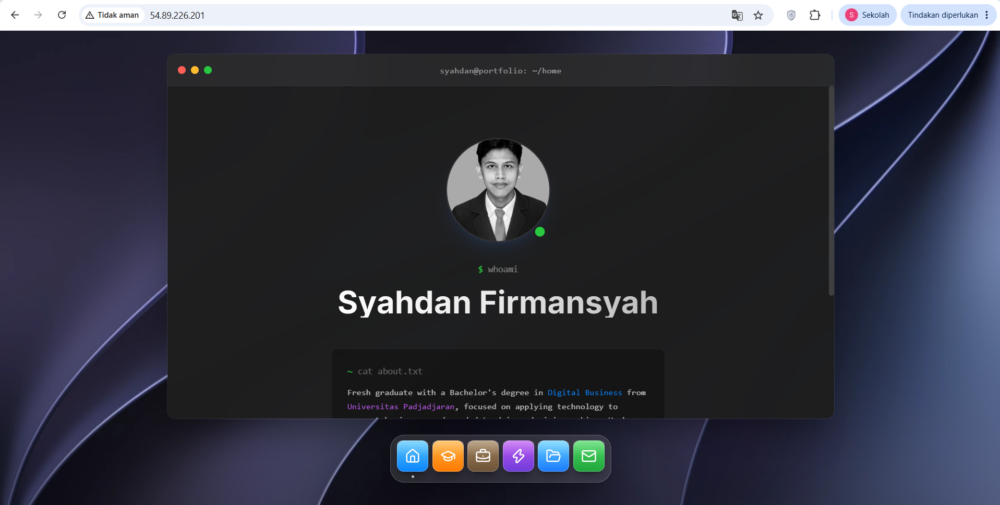
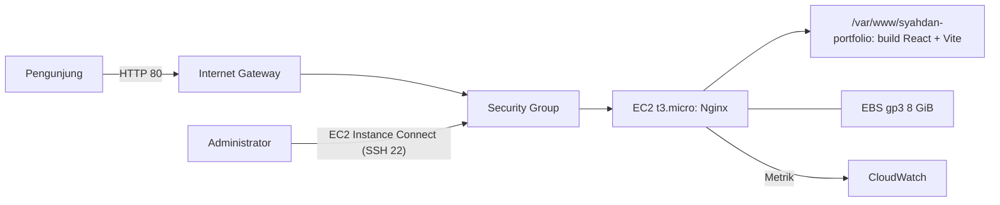

# Cloud Portfolio — Deployment React + Vite ke AWS EC2

Website portofolio pribadi (React + Vite) yang saya deploy ke Amazon EC2 dengan Nginx, lalu saya uji, pantau utilisasinya, dan analisis biayanya.

> **Status: Selesai.** Deployment berhasil dan fungsi utama lulus pengujian (8 dari 8 skenario, hasil pengujian manual).
> **Lingkungan:** AWS Academy / Skill Builder Lab, bukan akun produksi. Biaya yang tercantum adalah **estimasi harga publik**, bukan tagihan aktual.

**Kode sumber:** https://github.com/Syahdan24-Danz/syahdanf
**Alamat saat deployment:** `http://54.89.226.201` (IP publik otomatis dari lab; dapat berubah atau mati ketika lab dihentikan)



## Ringkasan

| Aspek | Hasil |
|---|---|
| Aplikasi | React 18 + Vite 6, Tailwind CSS, Framer Motion; 6 menu: Home, Education, Work Experience, Skills, Projects, Contact |
| Compute | Amazon EC2 `t3.micro` (2 vCPU, 1 GiB RAM), Amazon Linux 2023, `us-east-1c` |
| Storage | Amazon EBS gp3 8 GiB |
| Jaringan | VPC, public subnet, Internet Gateway, Security Group (HTTP 80 terbuka, SSH 22 dibatasi) |
| Web server | Nginx 1.30.6 melayani file statis hasil `vite build` |
| Pengujian | 8 dari 8 skenario fungsional PASS |
| Monitoring | CPU rata-rata puncak 9,27% saat build, kondisi normal di bawah 1%; memori terpakai 198 MiB dari 913 MiB; disk 30% |
| Estimasi biaya | ±$11,88/bulan untuk 24/7; ±$1,87/bulan untuk 80 jam lab |

## Arsitektur



Detail ada di [architecture/architecture.md](architecture/architecture.md) dan [docs/02-cloud-architecture.md](docs/02-cloud-architecture.md).

## Progres

- [x] Build lokal berhasil; folder `dist/` tersedia.
- [x] EC2 dibuat dan berstatus Running.
- [x] Akses melalui EC2 Instance Connect berhasil.
- [x] Nginx terpasang dan website dapat diakses melalui public IPv4.
- [x] Pengujian fungsional dilakukan (8/8 PASS).
- [x] Monitoring CloudWatch dan pemeriksaan Linux dilakukan.
- [x] Analisis biaya AWS dan perbandingan dengan Tencent Cloud disusun.

## Dokumentasi

| No | Dokumen | Isi |
|---|---|---|
| 1 | [Ringkasan proyek](docs/01-project-overview.md) | Tujuan, ruang lingkup, progres, kriteria keberhasilan |
| 2 | [Arsitektur cloud](docs/02-cloud-architecture.md) | Komponen, konfigurasi aktual, alur akses, keamanan |
| 3 | [Panduan deployment](docs/03-deployment-guide.md) | Langkah deployment, konfigurasi Nginx, masalah yang ditemui |
| 4 | [Pengujian dan validasi](docs/04-testing-validation.md) | 8 test case, bukti, verifikasi tambahan |
| 5 | [Monitoring dan utilisasi](docs/05-monitoring-utilization.md) | CPU, jaringan, memori, disk, rekomendasi |
| 6 | [Analisis biaya AWS](docs/06-cost-analysis.md) | Estimasi 24/7 dan skenario lab |
| 7 | [AWS vs Tencent Cloud](docs/07-aws-vs-tencent-cloud.md) | Perbandingan biaya dan infrastruktur |
| - | [Arsitektur (diagram)](architecture/architecture.md) | Diagram, keputusan desain, peningkatan berikutnya |

## Struktur Folder

```text
.
├── src/                    Aplikasi React (components, assets, styles)
├── public/                 Aset statis
├── architecture/           Diagram dan keputusan desain
├── docs/                   Dokumentasi 01 sampai 07
├── screenshots/
│   ├── project-overview/   Build lokal
│   ├── architecture/       EC2, Security Group, EBS, jaringan, route table
│   ├── deployment/         Koneksi, instalasi Nginx, build, konfigurasi, website live
│   ├── testing/            Bukti pengujian fungsional
│   ├── monitoring/         CPU, jaringan, resource Linux
│   ├── comparison/         Harga AWS dan Tencent Cloud
│   └── archive/            Bukti dari percobaan deployment sebelumnya (tidak dirujuk)
└── README.md
```

## Menjalankan Secara Lokal

Repository memiliki `pnpm-lock.yaml`.

```bash
pnpm install
pnpm dev        # server pengembangan
pnpm build      # build produksi ke dist/
pnpm preview    # pratinjau hasil build
```

Pada instance EC2, build dijalankan dengan `npm` (lihat [panduan deployment](docs/03-deployment-guide.md)).

## Batasan

- Menggunakan AWS Academy / Skill Builder Lab: izin IAM, durasi, dan layanan dapat dibatasi; ini bukan pengalaman produksi.
- Hanya HTTP; belum ada domain kustom dan HTTPS, sehingga browser menampilkan "Tidak aman".
- Satu instance di satu Availability Zone, tanpa load balancer atau Auto Scaling.
- Deployment manual (clone, build, salin); belum ada CI/CD.
- Pengujian bersifat manual dan fungsional; belum ada load test, pengukuran response time, atau uji keamanan.
- Monitoring hanya mencakup periode pengamatan singkat dan tidak mencakup memori melalui CloudWatch.
- Biaya adalah estimasi dari harga publik; tidak ada data tagihan aktual dan tidak ada penghematan yang diklaim.
- Tencent Cloud tidak di-deploy; perbandingannya hanya berdasarkan harga publik.
