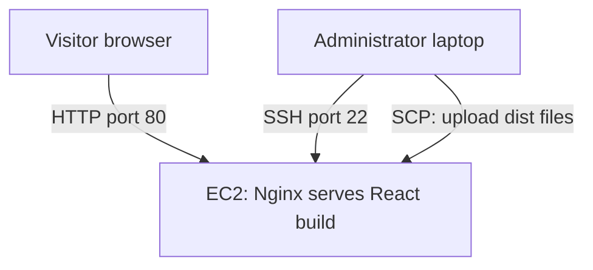

# React Portfolio Deployment on AWS EC2

Deploying a React portfolio website on Amazon EC2 using Nginx.

**Author:** Syahdan Firmansyah  
**Status:** Website accessible; deployment documentation in progress.

## Project Overview

This project demonstrates the deployment of an existing React and Vite
portfolio website to an Ubuntu EC2 instance.

The application was built locally, and the generated static files were
uploaded to the instance. Nginx serves these files to visitors over HTTP.

## Objectives

- Deploy a React application to Amazon EC2.
- Connect to a Linux instance using SSH.
- Configure security group rules for administrative and web access.
- Configure Nginx to serve the application.
- Verify initial website access through a browser.

## Technologies

| Technology | Purpose |
|---|---|
| Amazon EC2 | Virtual server hosting |
| Security Group | Instance network access control |
| Ubuntu Linux | Server operating system |
| SSH | Remote server administration |
| SCP | Build file transfer |
| Nginx | Static web server |
| React and Vite | Frontend application and build tooling |

## Architecture

The frontend runs in the visitor's browser. Nginx serves the static files
generated by Vite. No backend or database was deployed in this project.

## Deployment Summary

1. Prepared the React application and generated a local production build.
2. Created an Ubuntu EC2 instance.
3. Connected to the instance using SSH.
4. Installed Nginx.
5. Uploaded the contents of the local dist directory.
6. Configured Nginx to serve the application.
7. Opened the website through the instance's public IP address.

## Current Result

The website has loaded successfully in the browser, as confirmed by the
author. Individual command outputs and detailed test evidence are still
being documented.

## Documentation

- [Project Overview](docs/01-project-overview.md)
- [Deployment Guide](docs/02-deployment-guide.md)
- [Testing](docs/03-testing.md)

## Limitations

- The current deployment uses HTTP.
- A custom domain and HTTPS have not been configured.
- Monitoring and cost analysis have not been completed.
- Availability after an instance reboot has not been verified.
- This is a learning deployment on a single instance.

## Evidence

Website and infrastructure screenshots will be added after collection.