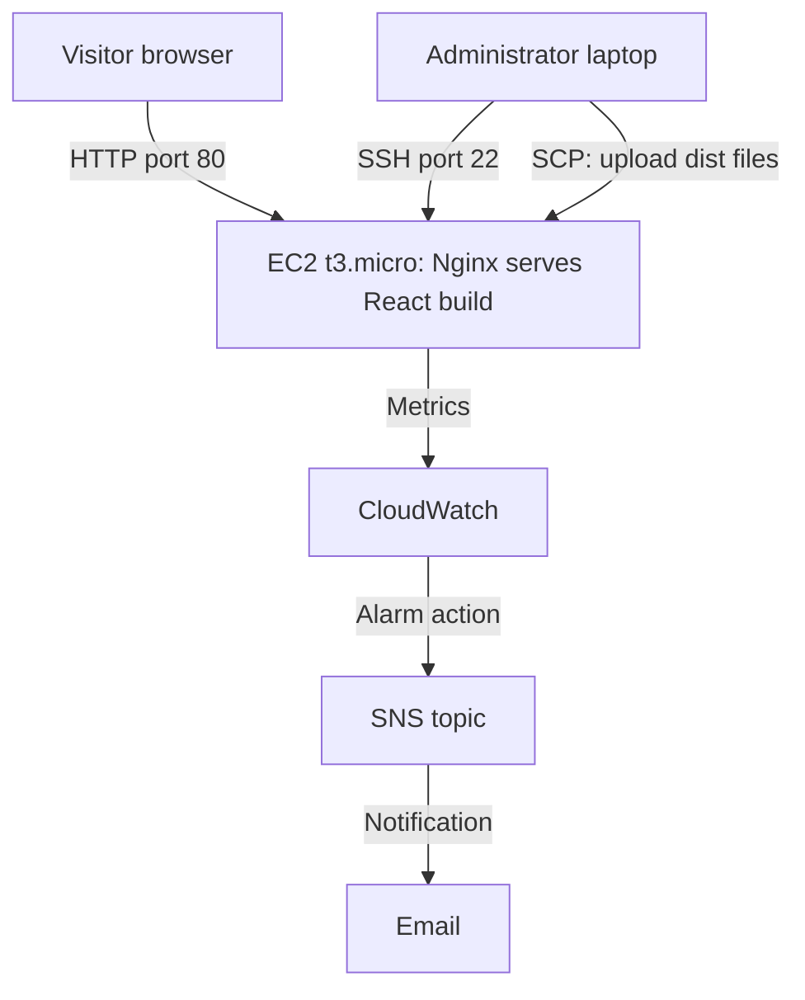

# Syahdan Firmansyah — Portfolio Website on AWS EC2

An interactive, macOS-inspired personal portfolio built with React, deployed
to Amazon EC2 and served by Nginx, with CloudWatch monitoring and an SNS
email alert.

**Author:** Syahdan Firmansyah — Digital Business graduate, Universitas
Padjadjaran, with a focus on cloud computing (AWS Certified Cloud Practitioner)
**Source code:** https://github.com/Syahdan24-Danz/syahdanf
**Status:** Deployed and verified on 2 November 2026 in an AWS lab
environment. The lab instance has since been shut down, so there is no
public URL. The screenshots in this repository are the deployment evidence.


## Why This Project

I built the portfolio to present my background, and deployed it myself to get
hands-on experience with the AWS fundamentals behind a real website: compute,
networking, access control, a Linux web server, monitoring, and cost.

The project has two parts:

| Part | What it covers |
|---|---|
| **The application** | A React + Vite single-page portfolio with a terminal/macOS look: Home, Education, Work Experience, Skills, Projects, and Contact |
| **The deployment** | An Ubuntu EC2 instance, a security group (SSH limited to the administrator's IP by design), Nginx serving the static build, CloudWatch metrics, an SNS email alert, and a cost estimate |

## Architecture



The frontend runs in the visitor's browser. Nginx only serves the static
files generated by Vite. No backend or database was deployed. See
[architecture/architecture.md](architecture/architecture.md) for the design
decisions and trade-offs.

## Technologies

| Technology | Purpose |
|---|---|
| React 18 and Vite | Frontend application and build tooling |
| Tailwind CSS and Framer Motion | Styling and animation |
| Amazon EC2 (t3.micro, Ubuntu) | Virtual server hosting |
| Security Group | Instance network access control |
| SSH and SCP | Remote administration and build file transfer |
| Nginx | Static web server |
| Amazon CloudWatch | Instance metrics and CPU alarm |
| Amazon SNS | Email notification |

## Deployment Summary

1. Built the React application locally to produce a production `dist` folder.
2. Launched an Ubuntu EC2 instance in `us-east-1` and configured the security group.
3. Connected over SSH and installed Nginx.
4. Uploaded the contents of `dist` to `/var/www/portfolio` with SCP.
5. Configured Nginx with a single-page-app fallback and validated it with `nginx -t`.
6. Opened the site through the instance's public IP address.
7. Observed metrics in CloudWatch and set up an SNS email topic for CPU alerts.

## Results

| Check | Result |
|---|---|
| Website opened through the EC2 public IP | Pass |
| Nginx service status | Active |
| Nginx configuration test | Syntax valid |
| Local HTTP request on the instance | `HTTP/1.1 200 OK` |
| CloudWatch CPU and network metrics | Visible |
| Manual SNS test email | Received |

Full test table, evidence, and the checks that were **not** completed are in
[docs/03-testing.md](docs/03-testing.md).

## Documentation

| Document | Content |
|---|---|
| [Project Overview](docs/01-project-overview.md) | Background, scope, environment, and network design |
| [Deployment Guide](docs/02-deployment-guide.md) | Step-by-step deployment commands |
| [Testing](docs/03-testing.md) | Test cases, results, and evidence |
| [Monitoring](docs/04-monitoring.md) | CloudWatch metrics, CPU alarm, and SNS notification |
| [Cost Analysis](docs/05-cost-analysis.md) | Monthly cost estimate from public AWS prices |
| [Troubleshooting](docs/06-troubleshooting.md) | Issues seen and checks for common problems |
| [Architecture](architecture/architecture.md) | Design decisions, trade-offs, and next steps |

## What I Learned

- How an EC2 instance, a public IP, and a security group work together to
  make an application reachable.
- Restricting SSH to a single administrator IP while keeping HTTP public.
- Serving a single-page application with Nginx, including the `try_files`
  fallback for frontend routes.
- Reading CloudWatch metrics for a burstable T3 instance, including CPU credits.
- Estimating monthly cost from public pricing, and separating an estimate from
  the real lab bill.
- Documenting results honestly: what passed, and what was not tested.

## Limitations

- The deployment used HTTP only. There was no custom domain or HTTPS, so the
  browser showed "Not secure".
- A single instance with no load balancer or Auto Scaling.
- The lab instance has been shut down; the site is no longer reachable.
- Navigation checks, a security group review, and a reboot test were not
  completed before the lab ended.
- A CloudWatch-triggered alarm email was not verified end to end.
- The cost analysis is a public-price estimate, not an actual invoice.

## Run Locally

The project uses pnpm.

```bash
pnpm install
pnpm dev        # development server
pnpm build      # production build in dist/
pnpm preview    # preview the production build
```

## Updating a Deployment

Rebuild locally, then upload the new `dist` contents to the web root:

```bash
pnpm build
scp -i YOUR_KEY.pem -r ./dist/. ubuntu@YOUR_PUBLIC_IP:/var/www/portfolio/
```

Nginx serves the files directly, so no restart is needed.

## Project Structure

```text
.
├── src/                 React application (components, assets, styles)
├── public/              Static assets
├── docs/                Deployment, testing, monitoring, cost, troubleshooting
├── architecture/        Architecture and design decisions
├── screenshots/         Deployment evidence
└── README.md
```

## Evidence

| File | Shows |
|---|---|
| [01-website-running.png](screenshots/01-website-running.png) | Portfolio loaded in the browser from the EC2 public IP |
| [02-ec2-instance-details.png](screenshots/02-ec2-instance-details.png) | Instance name, running state, and type |

The website screenshot was taken at deployment time, before later design
updates to the portfolio.
