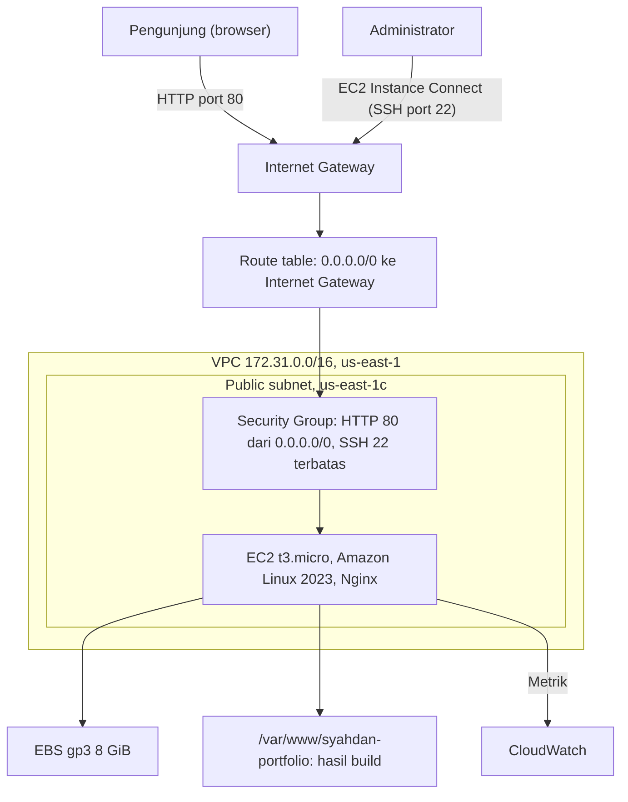
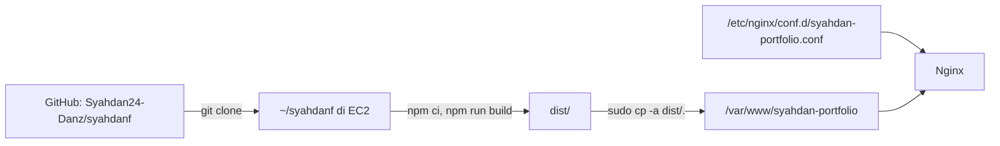

# Arsitektur

Website portofolio adalah aplikasi statis (React + Vite). File dibangun di instance, disalin ke direktori web, dan dilayani oleh Nginx pada satu instance EC2. Tidak ada backend maupun database.

Dokumen ini merangkum diagram dan keputusan desain. Nilai konfigurasi aktual dan buktinya ada di [docs/02-cloud-architecture.md](../docs/02-cloud-architecture.md).

## Diagram Jaringan dan Akses

## Diagram Deployment

Aplikasi dibangun langsung di instance, bukan di laptop lalu diunggah. Konsekuensinya, Git dan Node.js terpasang di server produksi, dan proses build memakai CPU dan memori instance (lihat lonjakan CPU pada [monitoring](../docs/05-monitoring-utilization.md)).

## Alur Request

1. Pengunjung membuka `http://<public-ip>`.
2. Permintaan masuk melalui Internet Gateway dan diperiksa Security Group pada port 80.
3. Nginx mengembalikan `index.html` dan file di `/assets/` (cache 7 hari).
4. Browser menjalankan aplikasi React. Perpindahan menu terjadi di browser tanpa permintaan halaman baru ke server.

## Komponen

| Komponen | Nilai | Fungsi |
|---|---|---|
| Region / AZ | us-east-1 / us-east-1c | Lokasi resource |
| EC2 | `t3.micro`, 2 vCPU, 1 GiB RAM | Menjalankan Nginx dan menyimpan website |
| OS | Amazon Linux 2023 | Sistem operasi server |
| EBS | gp3, 8 GiB | Penyimpanan OS dan file |
| VPC / Subnet | `vpc-021676310f284f4c8` / `subnet-0e1180bdf8df96d68` | Jaringan virtual |
| Internet Gateway | `igw-0d8ee8bdf9635a06e` | Koneksi VPC ke internet |
| Route table | `rtb-0098c5079eb3cdb7c` (main) | `0.0.0.0/0` ke Internet Gateway |
| Security Group | `syahdan-portfolio-sg` | Firewall instance |
| Nginx | 1.30.6 | Melayani file statis |
| CloudWatch | Metrik dasar EC2 | Memantau CPU dan jaringan |

## Keputusan Desain

| Keputusan | Alasan |
|---|---|
| Nginx melayani file statis | Aplikasi tidak memiliki backend, sehingga web server biasa sudah cukup |
| Satu instance `t3.micro` | Sederhana dan murah untuk lab; CPU tetap rendah pada pengamatan |
| `try_files $uri $uri/ /index.html` | Fallback standar untuk single page application |
| Cache 7 hari pada `/assets/` | Nama file hasil build memiliki hash, sehingga aman di-cache |
| EC2 Instance Connect | Tidak perlu mengelola file private key di laptop |
| HTTP port 80 terbuka untuk publik | Pengunjung harus dapat mengakses website |
| SSH dibatasi | Mengurangi risiko akses tidak sah |

## Batasan dan Trade-off

- **Tidak ada HTTPS dan domain kustom.** Lalu lintas tidak terenkripsi.
- **Single point of failure.** Satu instance, satu AZ, tanpa load balancer atau Auto Scaling.
- **Deployment manual.** Setiap pembaruan memerlukan login, `git pull`, build, dan salin.
- **Biaya untuk situs statis.** Instance yang menyala terus dan IPv4 publik lebih mahal daripada hosting statis ([analisis biaya](../docs/06-cost-analysis.md)).
- **Public IPv4 otomatis berubah** ketika instance dihentikan lalu dijalankan.
- **Monitoring dasar.** Metrik EC2 standar tidak menyertakan memori dan tidak menggambarkan ketersediaan website.

## Peningkatan yang Dapat Dilakukan

Belum diimplementasikan.

| Peningkatan | Manfaat |
|---|---|
| S3 + CloudFront untuk hosting statis | Tanpa server, HTTPS, biaya lebih rendah untuk konten statis |
| HTTPS dengan domain kustom | Lalu lintas terenkripsi, tanpa peringatan "Tidak aman" |
| Elastic IP | Alamat tetap |
| CI/CD (misalnya GitHub Actions) | Build dan deploy otomatis |
| Menghapus server block bawaan Nginx | Menghilangkan peringatan `conflicting server name` |
| CloudWatch Agent | Metrik memori dan disk di CloudWatch |
| CloudWatch Alarm + SNS | Notifikasi otomatis saat CPU tinggi |
