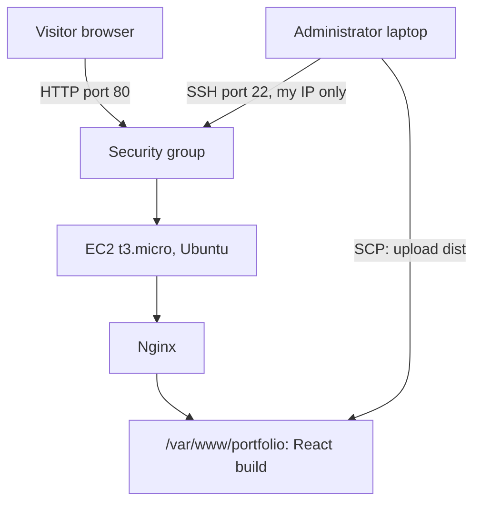
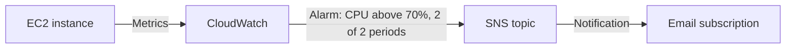

# Architecture

## Summary

The portfolio is a static single-page application. It is built once on a
laptop, copied to a single EC2 instance, and served by Nginx. CloudWatch and
SNS provide basic monitoring and an email alert.

## Deployment Architecture

| Component | Role |
|---|---|
| Visitor browser | Downloads the static files and runs the React app |
| Security group | Allows HTTP from anywhere and SSH only from the administrator's IP |
| EC2 t3.micro (us-east-1) | Hosts Nginx and the website files |
| Nginx | Serves static files and falls back to `index.html` |
| `/var/www/portfolio` | Web root containing the Vite build output |

## Monitoring Architecture

The alarm design and the manual SNS test are described in
[../docs/04-monitoring.md](../docs/04-monitoring.md). The end-to-end alarm
trigger was not verified.

## Request Flow

1. The visitor opens `http://<public-ip>`.
2. The request reaches the instance through the security group on port 80.
3. Nginx returns `index.html` and the files under `/assets/`.
4. The browser runs the React application. Section changes happen in the
   browser, with no further server requests for pages.

## Design Decisions

| Decision | Reason |
|---|---|
| Static build served by Nginx | The site has no backend or database, so a plain web server is enough |
| Single EC2 instance | Simple and cheap for a learning deployment |
| SSH restricted to one IP /32 | Reduces exposure of the administrative port |
| `try_files $uri $uri/ /index.html` | Standard single-page-app fallback |
| `/assets/` returns 404 when missing | A broken asset path fails visibly |
| Manual SCP upload | Keeps each deployment step visible for learning |

## Trade-offs and Limitations

- **No HTTPS or custom domain.** Traffic is unencrypted and browsers show
  "Not secure".
- **Single point of failure.** One instance in one Availability Zone, with no
  load balancer or Auto Scaling.
- **Manual deployment.** Uploads are done by hand and are error-prone.
- **Cost for a static site.** An always-on instance and public IPv4 address
  cost more than static hosting; see
  [../docs/05-cost-analysis.md](../docs/05-cost-analysis.md).
- **Monitoring is basic.** Standard EC2 metrics have no memory data and say
  nothing about website availability or response time.

## Possible Improvements

These were not implemented.

| Improvement | Benefit |
|---|---|
| Host the build on S3 with CloudFront | No server to manage, HTTPS, lower cost for static content |
| HTTPS with a custom domain (ACM or Let's Encrypt) | Encrypted traffic and no "Not secure" warning |
| Elastic IP | Stable address across stop and start |
| CI/CD with GitHub Actions | Automatic build and deploy on each push |
| CloudWatch Agent | Memory and disk metrics |
| Route 53 health check | Availability monitoring |
