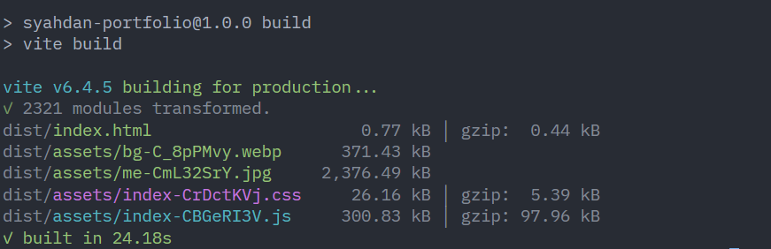
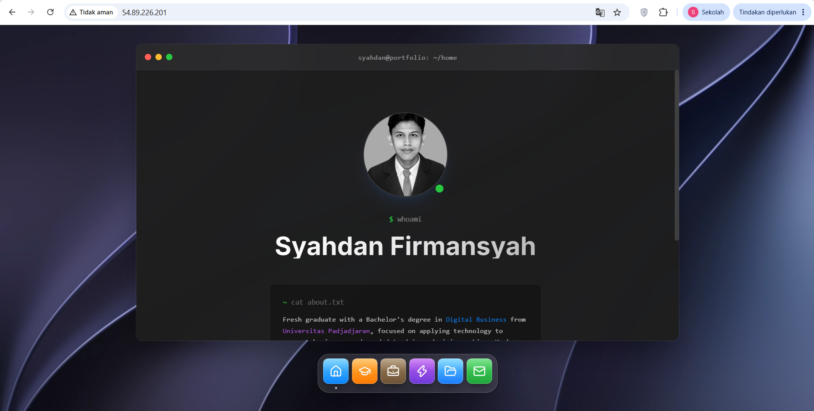

# 01 — Ringkasan Proyek

## Identitas Proyek

| Atribut | Keterangan |
|---|---|
| Nama proyek | Deployment Website Portofolio Pribadi di AWS EC2 |
| Jenis proyek | Skill Builder Lab |
| Peran | Pengembang aplikasi dan pelaksana deployment cloud |
| Aplikasi | Website portofolio pribadi |
| Frontend | React dan Vite |
| Platform cloud | Amazon Web Services (AWS) |
| Layanan yang digunakan | Amazon EC2, Amazon EBS, Amazon VPC, Security Group, Amazon CloudWatch |
| Web server | Nginx |
| Repository | https://github.com/Syahdan24-Danz/syahdanf |
| Status | **Selesai:** deployment berhasil, pengujian 8/8 PASS, monitoring dan analisis biaya disusun |

## Latar Belakang

Website portofolio pribadi dikembangkan menggunakan React dan Vite. Proyek ini mempraktikkan proses deployment aplikasi frontend ke infrastruktur cloud: persiapan instance, konfigurasi jaringan dan web server, pengujian, pemantauan utilisasi, hingga estimasi biaya.

## Tujuan

1. Menjalankan website portofolio pada instance Amazon EC2.
2. Mengonfigurasi akses jaringan melalui Security Group dan web server Nginx.
3. Memvalidasi akses publik dan fungsi utama website dengan skenario pengujian yang terdokumentasi.
4. Mengamati metrik utilisasi melalui CloudWatch dan sistem operasi.
5. Mengestimasi biaya AWS serta membandingkannya dengan Tencent Cloud untuk workload yang setara.
6. Menyusun bukti implementasi yang dapat diperiksa melalui dokumentasi dan screenshot.

## Ruang Lingkup

**Termasuk:** build aplikasi frontend, deployment statis, konfigurasi EC2/EBS/jaringan, pengujian fungsional sederhana, monitoring, estimasi biaya, dokumentasi, dan troubleshooting.

**Tidak termasuk:** backend, database, CI/CD otomatis, domain kustom, HTTPS, load balancer, dan Auto Scaling. Hal-hal ini dicatat sebagai pengembangan berikutnya di [architecture/architecture.md](../architecture/architecture.md).

## Arsitektur

Pengunjung → Internet → Internet Gateway → Security Group (HTTP 80) → EC2 (Nginx) → file statis hasil build React/Vite.

Penyimpanan instance menggunakan EBS gp3. Metrik EC2 diamati melalui CloudWatch. Diagram dan nilai aktual ada di [02 — Cloud Architecture](02-cloud-architecture.md).

## Progres dan Bukti

| Aktivitas | Status | Bukti |
|---|---|---|
| Pengembangan website React + Vite | Selesai | [Repository](https://github.com/Syahdan24-Danz/syahdanf) |
| Build lokal (`npm run build`) | Berhasil | [Screenshot](../screenshots/project-overview/01-build-success.png) |
| EC2 dibuat dan berjalan | Selesai | [Screenshot](../screenshots/architecture/01-ec2-instance.png) |
| Nginx terpasang | Selesai | [Screenshot](../screenshots/deployment/02-nginx-running.png) |
| Website dapat diakses publik | Selesai | [Screenshot](../screenshots/deployment/06-portfolio-live.png) |
| Pengujian fungsional | 8/8 PASS | [04 — Testing](04-testing-validation.md) |
| Monitoring | Selesai (pengamatan awal) | [05 — Monitoring](05-monitoring-utilization.md) |
| Analisis biaya | Selesai (estimasi) | [06 — Cost](06-cost-analysis.md) |
| Perbandingan AWS dan Tencent Cloud | Selesai (harga publik) | [07 — Comparison](07-aws-vs-tencent-cloud.md) |

## Bukti Visual

## Kontribusi Pribadi

Saya mengembangkan website portofolio menggunakan React dan Vite, menyiapkan instance EC2 dan konfigurasi jaringannya, memasang dan mengonfigurasi Nginx, melakukan deployment aplikasi, menguji hasilnya, memantau utilisasi, dan menyusun analisis biaya. Seluruh hasil diberi konteks **AWS Academy / Skill Builder Lab**, bukan pengalaman operasional produksi.

## Kriteria Keberhasilan

| Kriteria | Hasil |
|---|---|
| Website dapat diakses melalui alamat publik instance | Tercapai |
| Fungsi utama bekerja | Tercapai (8/8 test case) |
| Konfigurasi dan hasil pengujian terdokumentasi | Tercapai |
| Analisis biaya dengan asumsi eksplisit | Tercapai |

## Batasan

AWS Academy / Skill Builder Lab membatasi izin IAM, pilihan resource, durasi sesi, dan akses layanan. Contohnya, AWS Compute Optimizer tidak dapat digunakan (lihat [03 — Deployment Guide](03-deployment-guide.md#issue-2--aws-compute-optimizer-accessdenied)). Biaya yang dihitung adalah **estimasi**, bukan tagihan aktual.
