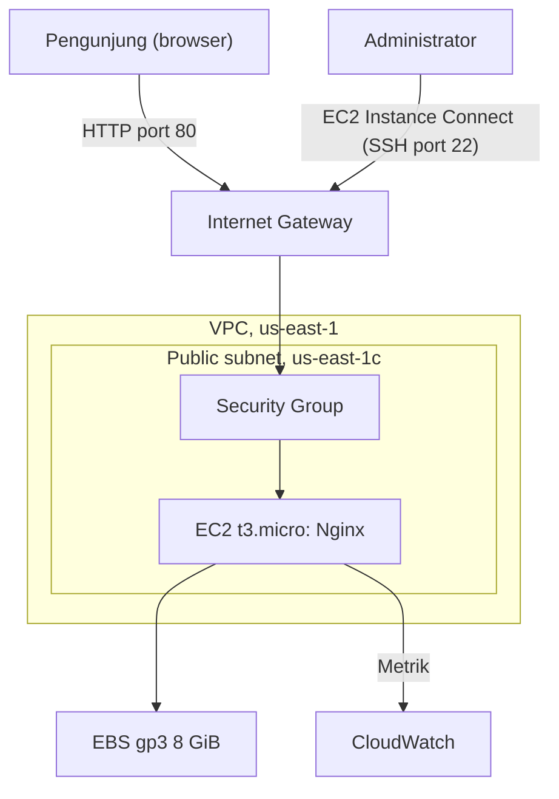
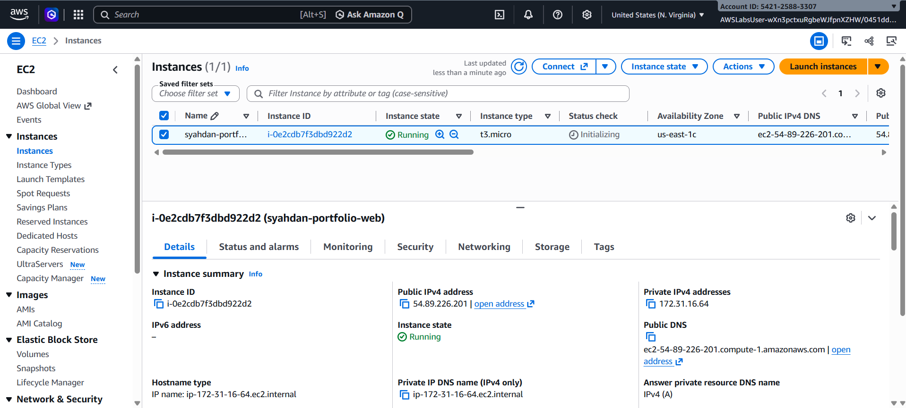
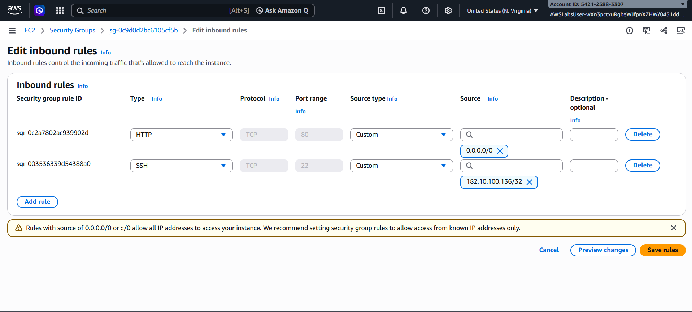
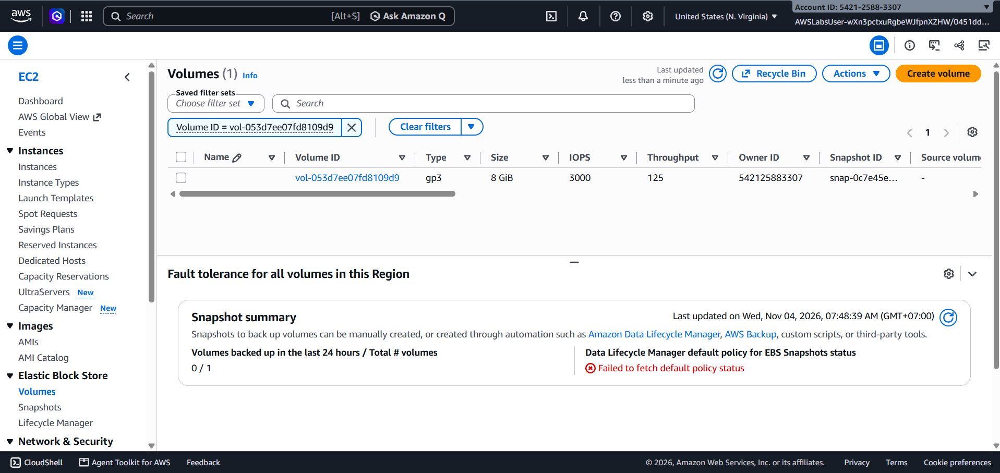
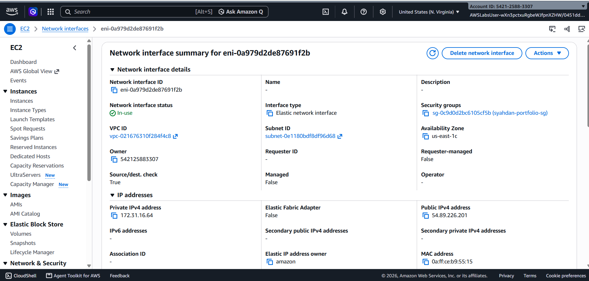
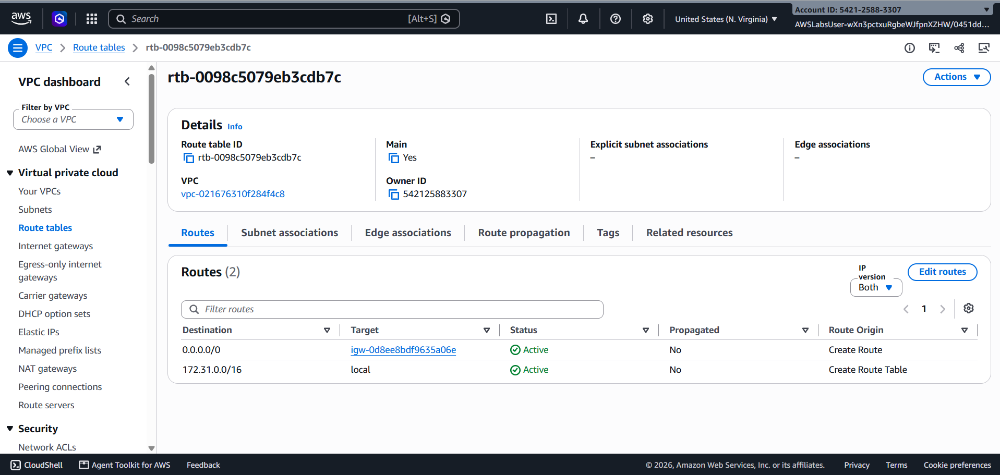

# 02 — Cloud Architecture

## 1. Ringkasan Arsitektur

Proyek ini mendeploy website portofolio berbasis React.js dan Vite menggunakan layanan Amazon Web Services (AWS) pada lingkungan AWS Academy / Skill Builder Lab.

Arsitektur menggunakan Amazon EC2 sebagai compute, Amazon EBS sebagai penyimpanan, Amazon VPC untuk jaringan, Security Group untuk kontrol akses, dan Amazon CloudWatch untuk monitoring.

**Status:** Diimplementasikan dan diverifikasi melalui screenshot AWS Console (4 November 2026).

## 2. Tujuan Arsitektur

- Menjalankan website React + Vite pada cloud server.
- Menyediakan akses website melalui public IPv4.
- Mengonfigurasi akses jaringan menggunakan Security Group.
- Menggunakan Nginx sebagai web server.
- Memantau utilisasi resource melalui CloudWatch.
- Mendokumentasikan konfigurasi dan hasil implementasi.

## 3. Diagram Arsitektur

Diagram deployment dan keputusan desain ada di [architecture/architecture.md](../architecture/architecture.md).

## 4. Komponen Infrastruktur

| Komponen | AWS Service | Fungsi |
|---|---|---|
| Compute | Amazon EC2 | Menjalankan web server |
| Storage | Amazon EBS | Menyimpan OS dan file aplikasi |
| Networking | Amazon VPC | Jaringan virtual |
| Subnet | Public Subnet | Penempatan instance |
| Internet Access | Internet Gateway | Koneksi internet VPC |
| Firewall | Security Group | Mengontrol trafik |
| Monitoring | Amazon CloudWatch | Memantau metrik instance |
| Web Server | Nginx | Melayani file website |

## 5. Konfigurasi Infrastruktur

Nilai aktual diambil dari screenshot AWS Console dan terminal.

| Parameter | Rencana | Aktual | Bukti |
|---|---|---|---|
| Region | us-east-1 | us-east-1 (N. Virginia) | [EC2](../screenshots/architecture/01-ec2-instance.png) |
| Availability Zone | - | us-east-1c | [EC2](../screenshots/architecture/01-ec2-instance.png) |
| Instance | t3.micro | t3.micro, `syahdan-portfolio-web` (`i-0e2cdb7f3dbd922d2`) | [EC2](../screenshots/architecture/01-ec2-instance.png) |
| AMI / OS | Amazon Linux 2023 | Amazon Linux 2023.12.20261102, user `ec2-user` | [Terminal](../screenshots/deployment/01-ec2-connected.png) |
| Storage | 8 GiB gp3 | `vol-053d7ee07fd8109d9`, gp3, 8 GiB, 3000 IOPS, 125 MB/s | [EBS](../screenshots/architecture/03-ebs-volume.png) |
| Public IPv4 | Enabled | `54.89.226.201` (private `172.31.16.64`) | [EC2](../screenshots/architecture/01-ec2-instance.png) |
| VPC | - | `vpc-021676310f284f4c8` | [Networking](../screenshots/architecture/04-ec2-networking.png) |
| Subnet | Public | `subnet-0e1180bdf8df96d68` | [Networking](../screenshots/architecture/04-ec2-networking.png) |
| Security Group | - | `syahdan-portfolio-sg` (`sg-0c9d0d2bc6105cf5b`) | [Networking](../screenshots/architecture/04-ec2-networking.png) |
| Route table | - | `rtb-0098c5079eb3cdb7c`: `0.0.0.0/0` ke `igw-0d8ee8bdf9635a06e`, `172.31.0.0/16` local | [Route table](../screenshots/architecture/05-route-table.png) |
| HTTP | 80 | TCP 80 dari `0.0.0.0/0` | [Security Group](../screenshots/architecture/02-security-group.png) |
| SSH | 22, akses terbatas | TCP 22 dari satu alamat IP /32 pada screenshot (lihat catatan) | [Security Group](../screenshots/architecture/02-security-group.png) |

> **Catatan SSH:** screenshot Security Group adalah halaman *Edit inbound rules* dan hanya menampilkan SSH dari satu alamat IP /32. Aturan akhir setelah perbaikan koneksi EC2 Instance Connect ([Issue 1](03-deployment-guide.md#issue-1--ec2-instance-connect-failed)) tidak terlihat pada screenshot. Ambil screenshot aturan akhir (halaman detail Security Group, tab *Inbound rules*) agar bagian ini terverifikasi sepenuhnya.

> Route table adalah *main route table* tanpa asosiasi subnet eksplisit, sehingga subnet menggunakannya secara implisit.

## 6. Alur Akses Website

1. Pengunjung memasukkan alamat IP publik EC2.
2. Permintaan HTTP dikirim ke port 80 melalui Internet Gateway.
3. Security Group memeriksa aturan inbound.
4. Nginx menerima permintaan.
5. Nginx mengirimkan file HTML, CSS, dan JavaScript hasil build Vite.
6. Browser menampilkan website portofolio.

Alur ini terbukti berjalan: halaman bawaan Nginx tampil lebih dulu ([screenshot](../screenshots/deployment/03-nginx-browser.png)), lalu website portofolio tampil setelah konfigurasi ([screenshot](../screenshots/deployment/06-portfolio-live.png)).

## 7. Pertimbangan Keamanan

- Membatasi akses SSH hanya dari sumber yang diperlukan.
- Membuka HTTP port 80 untuk pengunjung (AWS menampilkan peringatan untuk aturan `0.0.0.0/0`; ini disengaja untuk website publik).
- Tidak menyimpan private key atau kredensial di GitHub.
- Menggunakan permission sesuai batasan AWS Academy Lab.
- HTTPS belum dikonfigurasi; ini peningkatan berikutnya.
- Screenshot AWS Console memuat Account ID dan alamat IP pribadi. Sebelum repository dipublikasikan, tutup bagian tersebut (blur atau potong) pada screenshot.

## 8. Batasan Lingkungan Lab

AWS Academy / Skill Builder Lab memiliki batasan IAM, instance type, konfigurasi jaringan, dan durasi penggunaan. Batasan yang ditemui dicatat di [03 — Deployment Guide](03-deployment-guide.md#9-issues--troubleshooting).

## 9. Bukti Infrastruktur

### EC2 instance

### Security Group

### EBS volume

### Jaringan instance (VPC, subnet, public IPv4)

### Route table

## 10. Status Implementasi

- [x] Website React + Vite berhasil di-build.
- [x] Rancangan arsitektur disusun.
- [x] EC2 instance diverifikasi (Running, `t3.micro`).
- [x] Security Group diverifikasi (HTTP 80 terbuka). SSH: aturan akhir perlu screenshot tambahan.
- [x] Konfigurasi jaringan diverifikasi (VPC, subnet, route ke Internet Gateway).
- [x] Website berhasil diakses melalui public IPv4.
- [x] Monitoring CloudWatch diverifikasi ([05 — Monitoring](05-monitoring-utilization.md)).
