# 03 — Deployment Guide

## 1. Ringkasan Deployment

Proyek ini merupakan implementasi deployment website portofolio pribadi berbasis React.js dan Vite ke Amazon EC2 menggunakan AWS Academy / Skill Builder Lab.

Website dijalankan menggunakan Nginx sebagai web server untuk melayani file statis hasil production build Vite.

**Status Deployment: Berhasil**

Website berhasil diakses melalui public IPv4 EC2 menggunakan protokol HTTP.

## 2. Informasi Lingkungan

| Komponen | Konfigurasi |
|---|---|
| Cloud Provider | Amazon Web Services |
| Environment | AWS Academy / Skill Builder Lab |
| Region | us-east-1 |
| Availability Zone | us-east-1c |
| Instance Name | syahdan-portfolio-web |
| Instance ID | i-0e2cdb7f3dbd922d2 |
| Instance Type | t3.micro |
| Operating System | Amazon Linux 2023 (2023.12.20261102), user `ec2-user` |
| Storage | Amazon EBS gp3, 8 GiB (`vol-053d7ee07fd8109d9`) |
| Web Server | Nginx 1.30.6 |
| Application | React.js + Vite 6.4.5 |
| Public IPv4 | 54.89.226.201 |
| Repository | https://github.com/Syahdan24-Danz/syahdanf |
| Commit yang dideploy | Tidak dicatat saat deployment. Commit terakhir di repository sebelum deployment adalah `5711f9f` ("perbaiki hero"). Konfirmasi dengan `git rev-parse --short HEAD` di `~/syahdanf` pada instance. |

> Public IPv4 merupakan alamat otomatis dari AWS Lab dan dapat berubah setelah instance dihentikan atau lingkungan direset. Setelah lab dihentikan, alamat ini tidak lagi dapat diakses; bukti berupa screenshot di bagian 10.

## 3. Persiapan Infrastruktur

### 3.1 Membuat EC2 Instance

EC2 dibuat dengan konfigurasi:

- Instance Type: t3.micro
- Region: us-east-1
- Storage: 8 GiB gp3
- Public IPv4: Enabled
- VPC: vpc-021676310f284f4c8
- Subnet: subnet-0e1180bdf8df96d68

### 3.2 Security Group

Security Group digunakan untuk mengatur akses jaringan.

| Protocol | Port | Source | Fungsi |
|---|---|---|---|
| TCP | 80 | 0.0.0.0/0 | HTTP website |
| TCP | 22 | IP pengguna /32 (terlihat pada screenshot); sumber EC2 Instance Connect ditambahkan setelah perbaikan, aturan akhir belum terdokumentasi | SSH |

Akses SSH dibatasi untuk mengurangi risiko akses tidak sah. Screenshot Security Group saat ini menampilkan halaman *Edit inbound rules*; lampirkan screenshot aturan akhir agar pembatasan SSH dapat diverifikasi (lihat [02 — Cloud Architecture](02-cloud-architecture.md#5-konfigurasi-infrastruktur)).

### 3.3 Networking

Instance menggunakan public subnet dengan akses internet melalui Internet Gateway.

Konfigurasi jaringan:

- VPC ID: vpc-021676310f284f4c8
- Subnet ID: subnet-0e1180bdf8df96d68
- Internet Gateway: igw-0d8ee8bdf9635a06e
- Route Table: rtb-0098c5079eb3cdb7c (main route table)

Route menuju internet:

0.0.0.0/0 → Internet Gateway

## 4. Menghubungkan EC2

Koneksi dilakukan melalui EC2 Instance Connect.

Langkah:

1. Membuka AWS EC2 Console.
2. Memilih instance syahdan-portfolio-web.
3. Mengklik Connect.
4. Memilih EC2 Instance Connect.
5. Menghubungkan terminal ke instance.

Pada percobaan awal, koneksi SSH gagal karena aturan Security Group belum sesuai dengan sumber koneksi EC2 Instance Connect.

Setelah konfigurasi akses SSH diperbaiki, koneksi berhasil dilakukan. Terminal menampilkan prompt `ec2-user@ip-172-31-16-64` pada Amazon Linux 2023 ([screenshot](../screenshots/deployment/01-ec2-connected.png)).

## 5. Instalasi Nginx

Perintah instalasi untuk Amazon Linux 2023 (paket yang terpasang: `nginx-1.30.6-1.amzn2023`):

```bash
sudo dnf update -y
sudo dnf install nginx -y
```

Menjalankan Nginx:

```bash
sudo systemctl start nginx
sudo systemctl enable nginx
```

Memeriksa status:

```bash
sudo systemctl status nginx
```

Hasil:

Nginx berstatus `active (running)` dan `enabled` ([screenshot](../screenshots/deployment/02-nginx-running.png)). Halaman bawaan "Welcome to nginx!" dapat diakses melalui public IPv4 EC2 ([screenshot](../screenshots/deployment/03-nginx-browser.png)).

## 6. Deployment React + Vite

### 6.1 Instalasi Git dan Node.js

```bash
sudo dnf install git -y
```

Memeriksa Node.js dan npm:

```bash
node -v
npm -v
```

Jika belum tersedia:

```bash
sudo dnf install nodejs npm -y
```

Versi Node.js perlu disesuaikan dengan persyaratan Vite pada repository.

### 6.2 Clone Repository

```bash
cd ~

git clone https://github.com/Syahdan24-Danz/syahdanf.git

cd syahdanf
```

### 6.3 Instalasi Dependencies

Repository ini memakai pnpm dan hanya memiliki `pnpm-lock.yaml`; tidak ada `package-lock.json`. Karena itu `npm ci` tidak dapat dijalankan pada clone yang baru. Pada instance, `npm install` dijalankan lebih dulu (membuat `package-lock.json` di server), kemudian `npm ci` (terlihat pada [screenshot](../screenshots/deployment/04-react-build.png)).

```bash
npm install
npm ci
```

Untuk deployment ulang yang bersih, pertimbangkan menambahkan `package-lock.json` ke repository atau memasang pnpm di server.

### 6.4 Build Aplikasi

```bash
npm run build
```

Hasil build (Vite 6.4.5): 2432 modul, selesai dalam 7,16 detik, menghasilkan `dist/` berisi `index.html`, `bg-*.webp` (371 kB), `me-*.jpg` (2.376 kB), CSS (26 kB), dan JS (301 kB; 98 kB setelah gzip). Foto `me.jpg` berukuran 2,3 MB dan dapat dikompres untuk mempercepat pemuatan.

### 6.5 Menyiapkan Direktori Website

```bash
sudo mkdir -p /var/www/syahdan-portfolio
```

Menyalin hasil build:

```bash
sudo cp -a dist/. /var/www/syahdan-portfolio/
```

## 7. Konfigurasi Nginx

Contoh konfigurasi Nginx untuk React Single Page Application:

File:

`/etc/nginx/conf.d/syahdan-portfolio.conf`

```nginx
server {
    listen 80;
    server_name _;

    root /var/www/syahdan-portfolio;
    index index.html;

    location / {
        try_files $uri $uri/ /index.html;
    }

    location /assets/ {
        expires 7d;
        add_header Cache-Control "public";
    }
}
```

Konfigurasi di atas sama dengan yang ditampilkan pada [screenshot](../screenshots/deployment/05-nginx-config.png).

Validasi konfigurasi:

```bash
sudo nginx -t
```

Memuat ulang Nginx:

```bash
sudo systemctl reload nginx
```

`nginx -t` berhasil (`syntax is ok`, `test is successful`) tetapi menampilkan peringatan `conflicting server name "_" on 0.0.0.0:80, ignored`. Lihat [Issue 3](#issue-3--peringatan-conflicting-server-name-pada-nginx).

Lokasi file dan isi konfigurasi di atas sudah dicocokkan dengan screenshot dari instance.

## 8. Deployment Verification

Verifikasi dilakukan dengan mengakses:

http://54.89.226.201

Hasil:

- Website React + Vite berhasil ditampilkan.
- Website dapat diakses melalui browser.
- Nginx berhasil melayani aplikasi melalui HTTP.
- Pengujian fungsi utama menghasilkan 8 PASS dari 8 test case.

Verifikasi tambahan dari sisi server (pemeriksaan HTTP pada 4 November 2026): `HTTP/1.1 200 OK` dengan header `Server: nginx/1.30.6`; file JavaScript hasil build dilayani dengan header `Cache-Control: max-age=604800` (7 hari) sesuai konfigurasi; path `/assets/` yang tidak ada mengembalikan 404; route acak seperti `/halaman-acak` mengembalikan `index.html` (fallback SPA); port 443 tidak terjangkau karena HTTPS belum dikonfigurasi.

Detail pengujian tersedia pada:

[04 — Testing & Validation](04-testing-validation.md)

## 9. Issues & Troubleshooting

### Issue 1 — EC2 Instance Connect Failed

**Masalah:**

Failed to connect to your instance — Error establishing SSH connection.

**Analisis:**

Aturan SSH pada Security Group awalnya hanya mengizinkan alamat IP pengguna. Koneksi EC2 Instance Connect melalui browser memerlukan akses dari sumber yang sesuai.

**Penanganan:**

Konfigurasi aturan SSH disesuaikan agar metode koneksi EC2 Instance Connect dapat digunakan.

**Hasil:**

Koneksi terminal EC2 berhasil dilakukan.

### Issue 2 — AWS Compute Optimizer AccessDenied

**Masalah:**

Role AWSLabsUser tidak memiliki permission untuk menjalankan compute-optimizer:GetEnrollmentStatus.

**Dampak:**

Fitur Compute Optimizer tidak dapat digunakan untuk memperoleh rekomendasi otomatis.

**Penanganan:**

Analisis utilisasi dilakukan secara manual menggunakan CloudWatch dan metrik Linux ([05 — Monitoring](05-monitoring-utilization.md)).

### Issue 3 — Peringatan conflicting server name pada Nginx

**Masalah:**

`sudo nginx -t` menampilkan `nginx: [warn] conflicting server name "_" on 0.0.0.0:80, ignored`.

**Analisis:**

Konfigurasi baru di `/etc/nginx/conf.d/` dan server block bawaan di `/etc/nginx/nginx.conf` sama-sama memakai `server_name _` pada port 80. Nginx mengabaikan salah satunya. Website portofolio tampil dengan benar setelah reload, sehingga server block milik portofolio yang dipakai.

**Penanganan:**

Tidak ada perubahan yang dilakukan karena tidak memengaruhi fungsi. Untuk konfigurasi yang bersih, hapus atau nonaktifkan server block bawaan di `nginx.conf`, atau beri `server_name` yang spesifik.

**Hasil:**

Website berjalan normal; peringatan masih muncul.

## 10. Bukti Deployment

### EC2 Instance

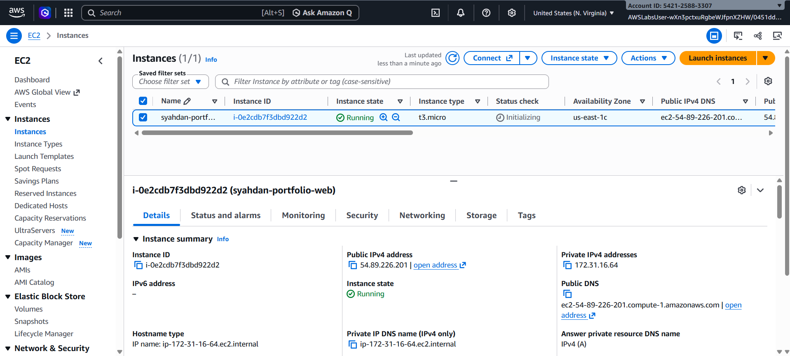

### Security Group

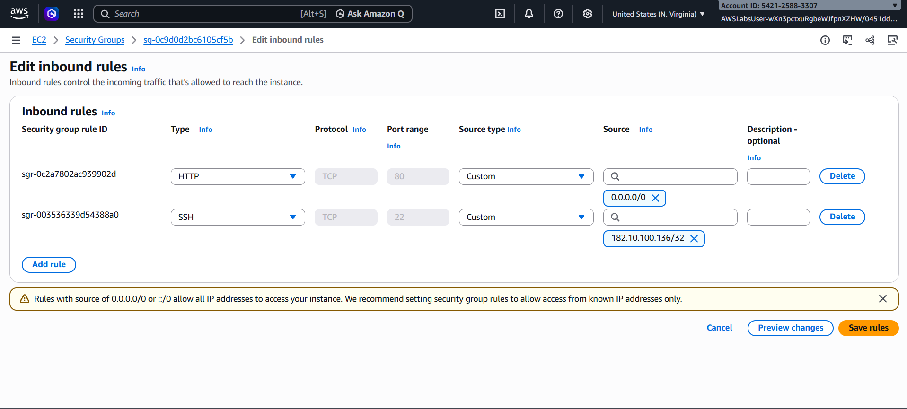

### EBS Volume

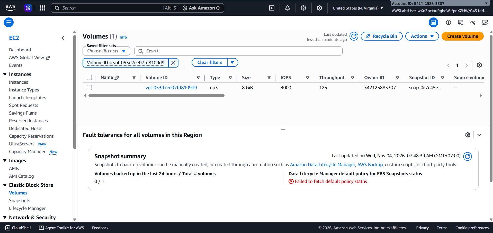

### Networking

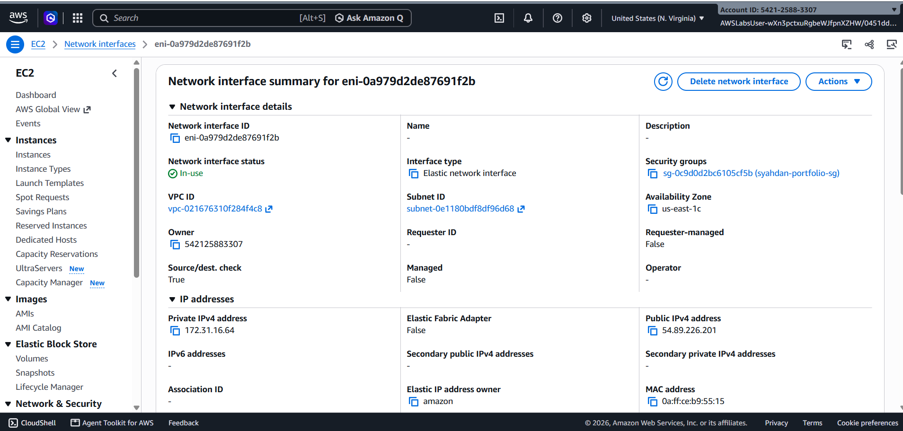

### Route Table

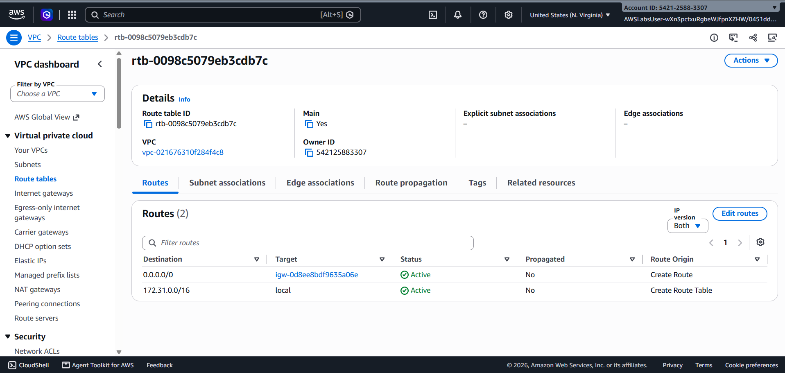

### Koneksi EC2 Instance Connect dan OS

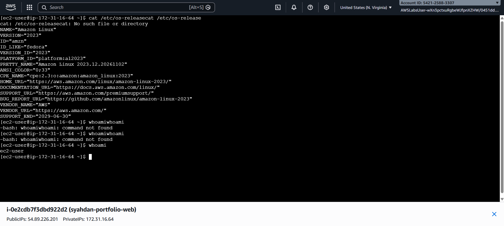

### Nginx berjalan

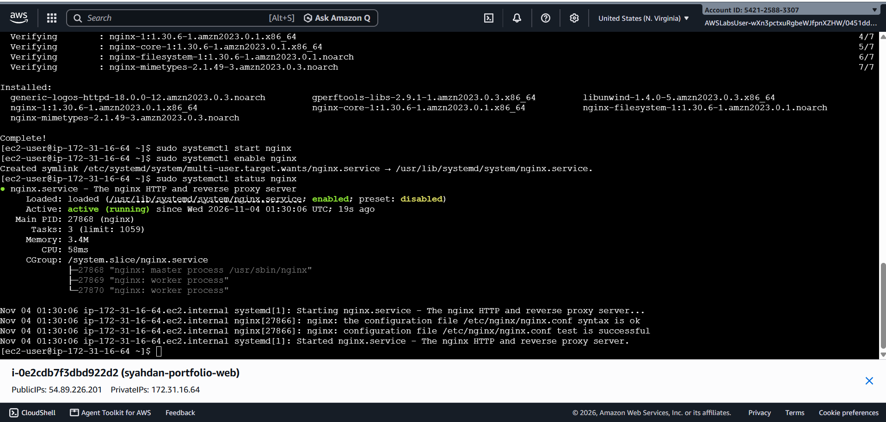

### Halaman bawaan Nginx

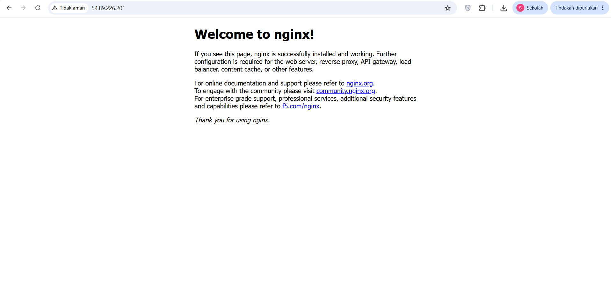

### Build React + Vite dan penyalinan ke direktori web

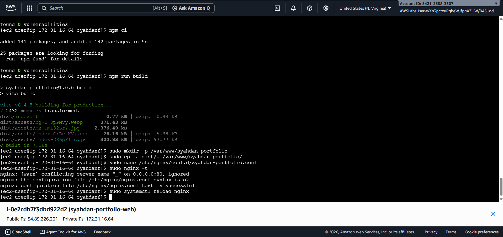

### Konfigurasi Nginx

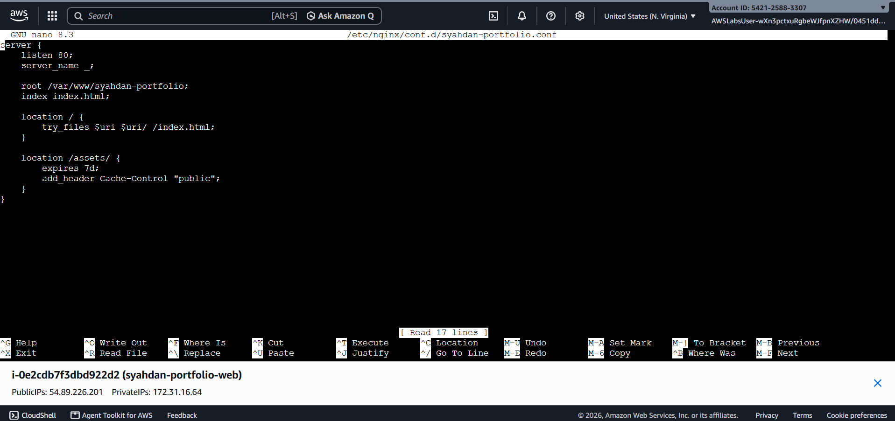

### Portfolio live

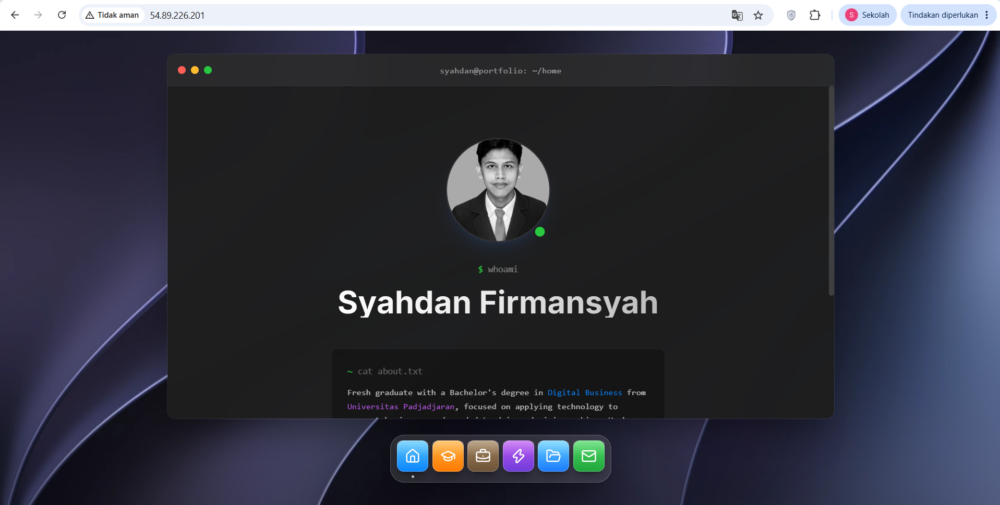

### Pengujian website

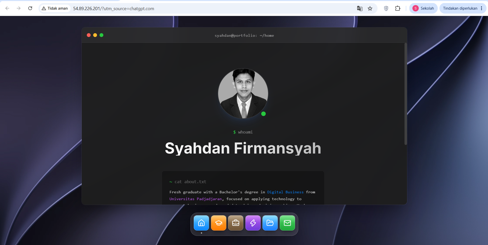

## 11. Kontribusi Pribadi

Sebagai pelaksana personal project menggunakan AWS Academy Lab, saya bertanggung jawab atas:

1. Menyiapkan instance Amazon EC2.
2. Mengonfigurasi Security Group dan akses jaringan.
3. Memverifikasi Amazon EBS, VPC, subnet, dan Internet Gateway.
4. Melakukan troubleshooting koneksi SSH.
5. Menginstal dan menjalankan Nginx.
6. Melakukan deployment aplikasi React + Vite.
7. Memvalidasi akses website melalui public IPv4.
8. Mendokumentasikan konfigurasi dan hasil implementasi.

## 12. Kesimpulan

Deployment website portofolio React + Vite pada Amazon EC2 berhasil dilakukan.

Implementasi ini memberikan pengalaman praktis dalam pengelolaan compute, storage, networking, konfigurasi web server, deployment aplikasi, dan troubleshooting cloud infrastructure.

Website berhasil diakses melalui public IPv4 dan telah melewati pengujian fungsional dasar.

**Deployment Status: SUCCESS**

**Environment: AWS Academy / Skill Builder Lab**
