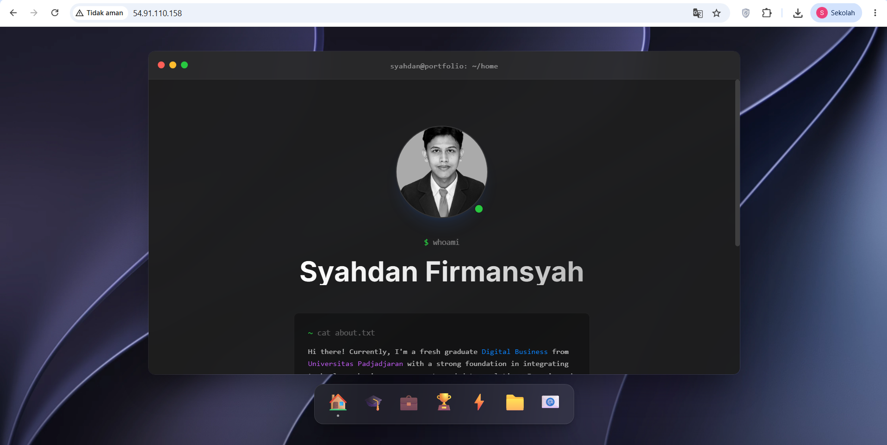
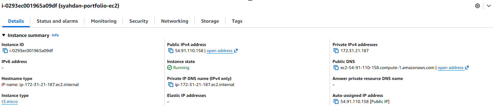

# Testing

This document records the checks run after deploying the portfolio to EC2,
the actual results, and the checks that were not completed.

## Test Details

- Date: 2 November 2026
- Recorded test time: 14:35 WIB (UTC+7)
- Tester: Syahdan Firmansyah
- Instance name: syahdan-portfolio-ec2
- Instance type: t3.micro
- Region: us-east-1
- Web server: Nginx 1.28.3 on Ubuntu

The recorded time represents the test session summary. The HTTP response
screenshot shows a request at 07:32:14 GMT (14:32:14 WIB).

## Test Results

| ID | Test | Actual Result | Status |
|---|---|---|---|
| T01 | Access website using the EC2 public IP | React portfolio displayed in the browser | PASS |
| T02 | Check Nginx service | Returned active | PASS |
| T03 | Validate Nginx configuration | Syntax valid; configuration test successful | PASS |
| T04 | Request website locally on EC2 | Returned HTTP/1.1 200 OK | PASS |
| T05 | Check all images, CSS, and icons | Initial page rendered; complete asset check not documented | NOT COMPLETED |
| T06 | Check navigation and buttons | Not documented | NOT COMPLETED |
| T07 | Refresh a valid frontend URL route | The app switches sections in memory and has no URL routes, so there is no route to refresh | N/A |
| T08 | Review security group rules | Rules not included in the evidence | NOT COMPLETED |
| T09 | Verify website after instance reboot | Not tested | NOT COMPLETED |

The lab instance was shut down after this session, so the checks marked
NOT COMPLETED can only be run again on a new deployment. T07 is N/A
because of how the application is built.

## Evidence

- Browser screenshot showing the deployed React portfolio:
  [01-website-running.png](../screenshots/01-website-running.png)
- EC2 screenshot showing the instance name, running state, and type:
  [02-ec2-instance-details.png](../screenshots/02-ec2-instance-details.png)
- Terminal screenshot showing Nginx service status, configuration
  validation, and the local HTTP response: not yet added to the
  repository.

## Observation

The website is currently served over HTTP. The browser displays
"Not secure" because HTTPS has not been configured.

An accidental attempt to execute the word active returned
"command not found". This did not affect the Nginx service.

## Conclusion

Initial deployment checks passed: the website is accessible, Nginx is
active, its configuration is valid, and the local server returns HTTP 200.

Full navigation, security group review, and reboot recovery were not
completed before the lab ended.