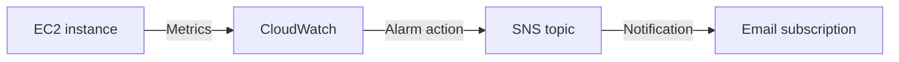

# EC2 Monitoring and Alerting

## Objective

Monitor the EC2 instance hosting the React portfolio and configure an
email notification for high CPU utilization.

The project uses Amazon CloudWatch to observe instance metrics and
Amazon SNS to deliver notifications.

## Monitored Environment

| Item | Configuration |
|---|---|
| Instance name | syahdan-portfolio-ec2 |
| Instance type | t3.micro |
| Region | US East (N. Virginia) — us-east-1 |
| Application | React portfolio served by Nginx |
| Monitoring service | Amazon CloudWatch |
| Notification service | Amazon SNS |
| Initial observation date | 2 November 2026 |
| Display timezone | Local timezone shown in CloudWatch |

## Architecture

## Metrics Observed

| Metric | Purpose |
|---|---|
| CPUUtilization | Observe the percentage of CPU used by the instance |
| NetworkIn | Observe bytes received by the instance |
| NetworkOut | Observe bytes sent by the instance |
| CPUCreditUsage | Observe CPU credits consumed by the T3 instance |
| CPUCreditBalance | Observe the available CPU credit balance |

Network metrics include traffic for the whole instance, such as website
requests, SSH, and file transfers. They do not directly represent the
number of website visitors.

## Initial Observation

The initial CloudWatch screenshot showed:

- CPU utilization near 4.24% at the beginning of the visible period,
  followed by lower values close to 0%.
- A NetworkIn spike around 14:00.
- NetworkOut spikes around 14:15 and 14:30.
- An increasing CPU credit balance during the visible period.

The CPU value above is an approximate reading from the chart; the exact
datapoint was not recorded.

The screenshot displayed a one-hour time range, the Average statistic,
and a one-minute graph period. The graph setting alone does not confirm
whether detailed monitoring was enabled.

The exact causes of the network spikes were not verified. The
observation period was short and does not represent sustained or peak
production traffic.

## Monitoring Configuration

The initial monitoring walkthrough used the following intended settings:

| Setting | Value |
|---|---|
| Metric | CPUUtilization |
| Statistic | Average |
| Intended analysis period | 5 minutes |
| Initial time range | 1 hour |

Basic EC2 monitoring generally provides CPU metric data in five-minute
periods. The actual monitoring mode should be checked in the EC2 console.

## CloudWatch CPU Alarm

| Setting | Intended Configuration |
|---|---|
| Alarm name | portfolio-ec2-high-cpu |
| Metric | CPUUtilization |
| Statistic | Average |
| Period | 5 minutes |
| Threshold | Greater than 70% |
| Evaluation | 2 out of 2 datapoints |
| Notification state | In alarm |
| SNS topic | portfolio-ec2-alerts |

The intended condition is an alarm when average CPU utilization exceeds
70% in two consecutive five-minute periods.

The author reported completing the alarm and SNS setup. The exact alarm
configuration and action should be supported by a CloudWatch alarm
details screenshot.

## Amazon SNS Notification

| Item | Status |
|---|---|
| SNS topic | portfolio-ec2-alerts |
| Subscription protocol | Email |
| Subscription confirmation | Author reported setup completed |
| Manual SNS test message | Email received |
| CloudWatch-triggered alarm email | Not yet verified |

A manually published SNS message reached the email inbox. This verifies
the SNS-to-email path for that test.

It does not by itself verify that CloudWatch entered ALARM and published
the notification. That end-to-end test remains pending.

## Test Results

| ID | Test | Result | Status |
|---|---|---|---|
| M01 | View EC2 metrics | CPU and network graphs visible | PASS |
| M02 | Review initial CPU usage | Approximate chart observation recorded | PASS |
| M03 | Send a manual SNS test message | Email received | PASS |
| M04 | Verify exact alarm settings and SNS action | Screenshot not recorded | NOT COMPLETED |
| M05 | Trigger CPU alarm and receive alarm email | Not reported | NOT COMPLETED |
| M06 | Confirm alarm returns to OK after load ends | Not reported | NOT COMPLETED |

The lab instance has been shut down, so M04 to M06 would need a new
deployment.

## Evidence

Screenshots still to be added to the `screenshots/` directory, redacted:

- EC2 Monitoring tab showing CPU and network metrics.
- CloudWatch CPUUtilization graph with time range and statistic.
- CloudWatch alarm details showing threshold and SNS action.
- SNS subscription showing its status.
- Manual SNS test email.
- Alarm notification email, after an end-to-end alarm test.

Remove or mask email addresses and account identifiers if they are not
needed in the public repository.

## Initial Findings

CPU usage was low for most of the short observation window. This alone
is not enough to recommend changing the instance size.

Memory utilization was not included in the observed standard EC2
metrics. A CloudWatch Agent and suitable permissions would be needed
to collect guest memory metrics in CloudWatch.

## Limitations

- The initial observation covered a short period.
- The cause of the network spikes was not verified.
- Exact CPU peak values were not captured by hovering over the graph.
- CloudWatch-triggered email delivery has not yet been verified.
- The monitoring data does not establish website availability or
  response time.
- Actual monitoring and notification charges have not been determined.

## Next Steps

On a future deployment:

1. Capture the exact CPU datapoints and confirm the monitoring period.
2. Verify the alarm configuration and SNS action in CloudWatch.
3. Perform and document an end-to-end alarm test.
4. Observe utilization over a longer, representative workload.
5. Install the CloudWatch Agent to collect memory metrics.
6. Include monitoring costs in the cost analysis.