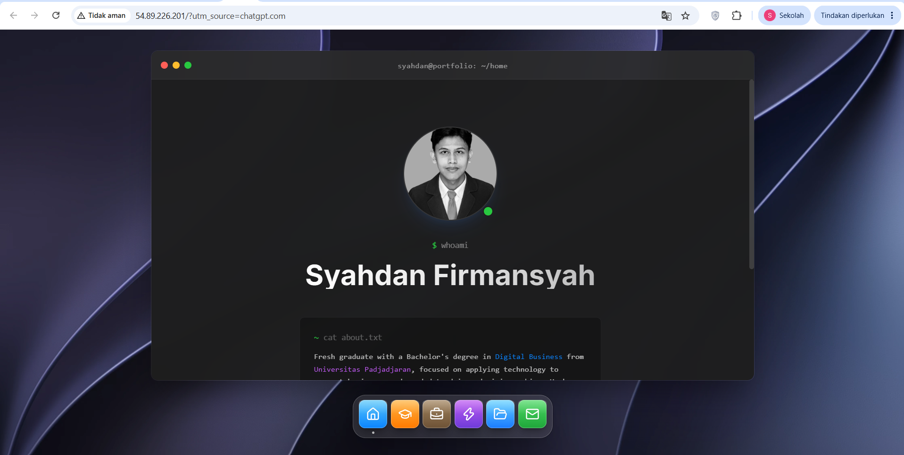
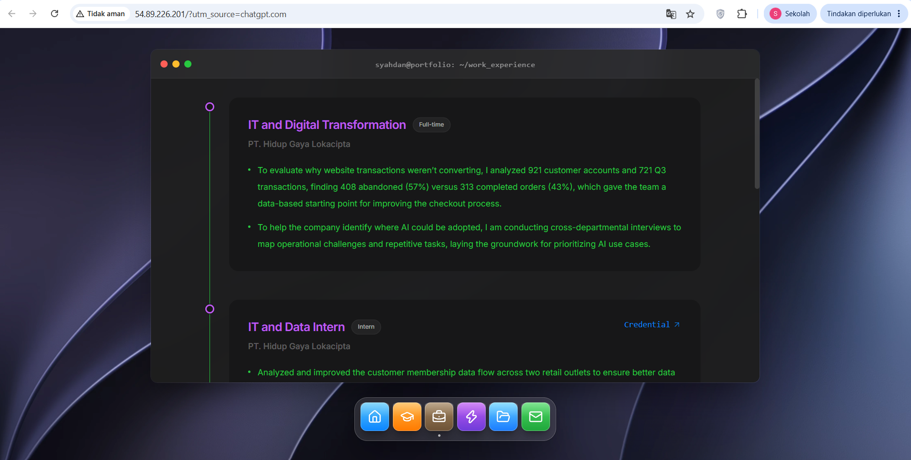
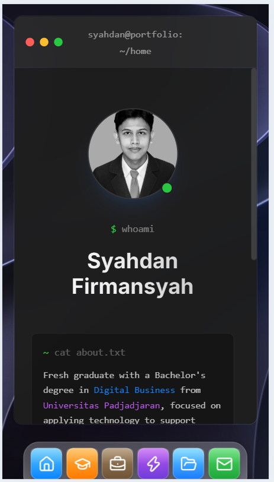

# 04 — Testing & Validation

## 1. Ringkasan Pengujian

Pengujian dilakukan untuk memvalidasi hasil deployment website portofolio pribadi berbasis React.js dan Vite pada Amazon EC2.

Pengujian menggunakan metode manual black-box testing dengan mengakses website melalui browser dan memeriksa fungsi-fungsi utama dari perspektif pengguna.

**Lingkungan pengujian:**

| Parameter | Keterangan |
|---|---|
| Cloud Provider | Amazon Web Services (AWS) |
| Environment | AWS Academy / Skill Builder Lab |
| Region | us-east-1 (N. Virginia) |
| Compute | Amazon EC2 t3.micro |
| Instance ID | i-0e2cdb7f3dbd922d2 |
| Web Server | Nginx 1.30.6 |
| Application | React.js + Vite |
| Public IPv4 saat pengujian | 54.89.226.201 |
| Metode | Manual Black-Box Testing |
| Tanggal pengujian | 4 November 2026 |
| Pelaksana | Pemilik proyek |

> Public IPv4 berasal dari lingkungan lab dan dapat berubah ketika instance dihentikan atau lingkungan lab direset.

Website memiliki 6 menu pada dock: Home, Education, Work Experience, Skills, Projects, dan Contact. Aplikasi berpindah menu di dalam browser tanpa mengubah URL, sehingga tidak ada route terpisah untuk diuji.

## 2. Tujuan Pengujian

- Memastikan website dapat diakses melalui public IPv4 EC2.
- Memastikan navigasi utama berfungsi.
- Memastikan halaman dan konten dapat ditampilkan.
- Memvalidasi tampilan responsif pada perangkat mobile.
- Memastikan website tetap dapat dimuat setelah refresh browser.

## 3. Test Scenario dan Hasil Aktual

| ID | Test Scenario | Expected Result | Actual Result | Status |
|---|---|---|---|---|
| TC-01 | Akses public IP | Website berhasil dibuka | Website berhasil diakses melalui public IP | PASS |
| TC-02 | Navigasi Home | Konten Home ditampilkan | Konten Home berhasil ditampilkan | PASS |
| TC-03 | Navigasi Education | Konten Education ditampilkan | Konten Education berhasil ditampilkan | PASS |
| TC-04 | Navigasi Work Experience | Konten pengalaman ditampilkan | Konten Work Experience berhasil ditampilkan | PASS |
| TC-05 | Navigasi Projects | Daftar proyek ditampilkan | Konten Projects berhasil ditampilkan | PASS |
| TC-06 | Navigasi Contact | Informasi kontak ditampilkan | Konten Contact berhasil ditampilkan | PASS |
| TC-07 | Responsive mobile | Layout menyesuaikan layar mobile | Layout berhasil menyesuaikan layar mobile | PASS |
| TC-08 | Refresh halaman | Website tetap dapat dimuat | Website berhasil dimuat kembali setelah refresh | PASS |

Hasil aktual di atas didasarkan pada pengujian manual yang dilaporkan oleh pelaksana proyek.

### Cakupan bukti

Tidak semua test case memiliki screenshot sendiri. Berikut yang benar-benar terlihat pada file bukti:

| Test Case | Screenshot | Yang terlihat |
|---|---|---|
| TC-01, TC-02 | `01-website-live.png` | Home tampil dari `54.89.226.201` |
| TC-04 | `02-navigation-test.png` | Halaman Work Experience tampil |
| TC-07 | `03-mobile-responsive.png` | Layout lebar sempit (Home, dock tetap terlihat) |
| TC-03, TC-05, TC-06, TC-08 | Belum ada screenshot khusus | Hasil PASS berasal dari laporan pelaksana |

### Menu yang tidak ada di skenario

Menu **Skills** tidak termasuk pada TC-02 sampai TC-06, sehingga hasil pengujiannya tidak tercatat. Total 8 test case mencakup 5 dari 6 menu. Tambahkan test case untuk Skills jika sudah diuji.

### Verifikasi tambahan dari sisi server

Pemeriksaan HTTP langsung ke server pada 4 November 2026 mendukung beberapa hasil di atas:

| Pemeriksaan | Hasil |
|---|---|
| `GET /` | `HTTP/1.1 200 OK`, `Server: nginx/1.30.6`, mereferensikan `index-DZ6pFIrc.js` dan `index-CrDctKVj.css` |
| `GET /assets/index-DZ6pFIrc.js` | `200 OK`, `Cache-Control: max-age=604800` |
| `GET /halaman-acak` | `200` dengan `text/html` (fallback ke `index.html`; refresh pada URL apa pun tetap memuat aplikasi) |
| `GET /assets/tidak-ada.js` | `404` |
| HTTPS port 443 | Tidak terjangkau (HTTPS belum dikonfigurasi) |

Nama file JS dan CSS sama dengan hasil build di instance ([screenshot build](../screenshots/deployment/04-react-build.png)).

## 4. Ringkasan Hasil

| Metrik | Hasil |
|---|---|
| Total Test Case | 8 |
| Passed | 8 |
| Failed | 0 |
| Not Tested | 0 |
| Pass Rate | 100% |

Rumus:

Pass Rate = (Passed Test Cases / Total Test Cases) × 100%

Pass Rate = (8 / 8) × 100% = 100%

## 5. Evidence / Bukti Pengujian

### TC-01 — Website Live

### TC-02 sampai TC-06 — Navigation Testing

### TC-07 — Mobile Responsive

> Seluruh screenshot diambil dari website yang berjalan di EC2 (`54.89.226.201`).

## 6. Issues dan Findings

Selama delapan skenario pengujian yang dilaporkan, tidak ditemukan kegagalan fungsi.

Tidak ada issue fungsional yang dicatat pada tahap ini.

Namun, pengujian belum mencakup:
- Menu Skills (tidak ada pada skenario).
- Load testing dan stress testing.
- Pengukuran response time.
- Pengujian keamanan aplikasi.
- Pengujian kompatibilitas seluruh browser.
- Pengujian availability jangka panjang.

## 7. Kontribusi Pribadi

Dalam tahap testing, saya melakukan:

1. Penyusunan skenario pengujian fungsi utama website.
2. Pengujian akses website melalui public IPv4 EC2.
3. Validasi navigasi dan tampilan responsif.
4. Pengujian refresh halaman.
5. Pencatatan expected result dan actual result.
6. Dokumentasi hasil pengujian sebagai bukti implementasi cloud.

## 8. Kesimpulan

Berdasarkan delapan test case yang dilaksanakan, seluruh skenario pengujian memperoleh status PASS dengan tingkat keberhasilan 100%.

Hasil ini menunjukkan bahwa deployment website React + Vite pada Amazon EC2 telah memenuhi kebutuhan fungsional dasar yang diuji.

Pengujian lanjutan masih diperlukan untuk mengevaluasi performa, keamanan, dan keandalan aplikasi pada kondisi penggunaan yang lebih luas.

**Status: Functional Testing — PASS (8/8).**
