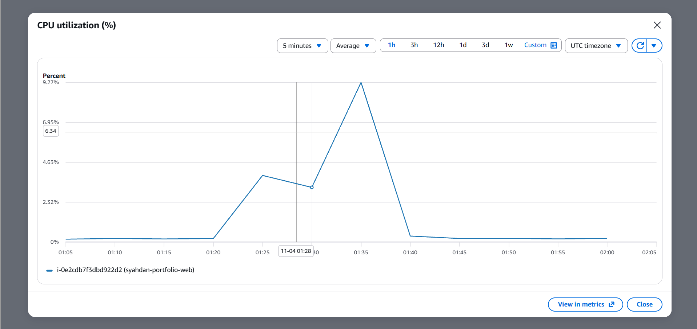
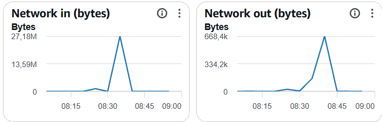
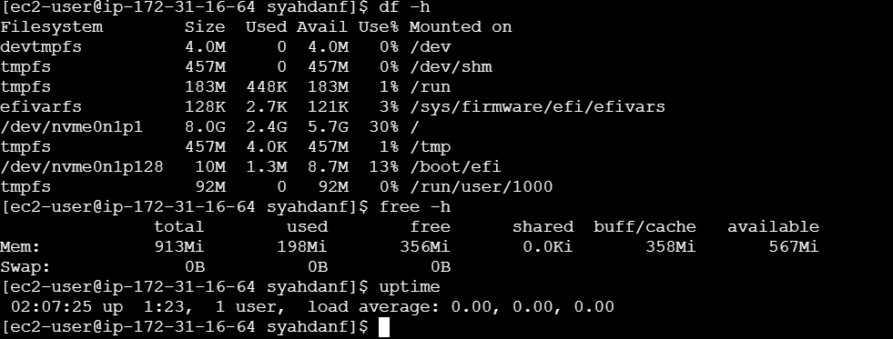

# 05 — Monitoring & Resource Utilization

## 1. Ringkasan Monitoring

Monitoring dilakukan untuk mengevaluasi penggunaan sumber daya Amazon EC2 setelah deployment website portofolio berbasis React.js dan Vite.

Pengamatan memakai Amazon CloudWatch (CPU dan jaringan) dan perintah Linux (disk, memori, load average).

Hasil monitoring menjadi dasar evaluasi efisiensi infrastruktur dan rekomendasi optimasi biaya.

**Environment:** AWS Academy / Skill Builder Lab  
**Status:** Monitoring awal selesai  
**Tanggal pencatatan:** 4 November 2026

## 2. Informasi Infrastruktur

| Parameter | Konfigurasi |
|---|---|
| Cloud Provider | Amazon Web Services |
| Region | us-east-1 |
| Availability Zone | us-east-1c |
| Instance Name | syahdan-portfolio-web |
| Instance ID | i-0e2cdb7f3dbd922d2 |
| Instance Type | t3.micro (2 vCPU, 1 GiB RAM) |
| Storage | Amazon EBS gp3, 8 GiB |
| Web Server | Nginx 1.30.6 |
| Application | React.js + Vite |
| Monitoring | Amazon CloudWatch (metrik dasar), Linux CLI |

## 3. Tujuan Monitoring

1. Mengidentifikasi tingkat penggunaan CPU.
2. Mengamati aktivitas jaringan inbound dan outbound.
3. Mengukur penggunaan storage dan memori.
4. Mengevaluasi kecukupan resource EC2.
5. Mengidentifikasi peluang optimasi infrastruktur.
6. Menyediakan data pendukung analisis biaya cloud.

## 4. Metode Pengumpulan Data

### 4.1 Amazon CloudWatch

Metrik diperoleh melalui: AWS Console → EC2 → Instances → Monitoring.

Metrik yang diamati: `CPUUtilization`, `NetworkIn`, `NetworkOut`.

Pengaturan grafik CPU yang terlihat pada screenshot:

| Pengaturan | Nilai |
|---|---|
| Periode | 5 menit |
| Statistik | Average |
| Rentang waktu | 1 jam (01:05–02:05) |
| Zona waktu grafik CPU | UTC |

Grafik jaringan menggunakan satuan **bytes** dan zona waktu lokal (WIB, UTC+7). Periode grafik jaringan tidak terlihat pada potongan screenshot.

### 4.2 Linux CLI

```bash
df -h
free -h
uptime
```

Ketiganya dijalankan pada instance pada 4 November 2026 pukul 02:07 UTC (09:07 WIB).

## 5. Hasil Monitoring

| Metrik | Nilai | Sumber |
|---|---|---|
| CPU Utilization (kondisi normal) | ±0,2–0,3% (dicatat 0,27%) | CloudWatch |
| CPU Utilization (puncak) | 9,27% (Average, 5 menit, sekitar 01:35 UTC) | CloudWatch |
| Network In (puncak) | 27,18 MB | CloudWatch |
| Network Out (puncak) | 668,4 kB | CloudWatch |
| Disk terpakai | 2,4 GiB dari 8,0 GiB (30%), tersisa 5,7 GiB | `df -h`, `/dev/nvme0n1p1` |
| Memori | 198 MiB terpakai dari 913 MiB (±22%); 567 MiB tersedia; swap 0 | `free -h` |
| Load average | 0,00 / 0,00 / 0,00 (uptime 1 jam 23 menit) | `uptime` |

Catatan:
- Nilai 0,27% dicatat sebagai kondisi normal; grafik menunjukkan baseline sekitar 0,2% di luar jendela deployment.
- Puncak CPU, Network In, dan Network Out terjadi di sekitar waktu yang sama (±08:35–08:40 WIB / 01:35–01:40 UTC), tepat sebelum file hasil build disalin ke direktori web pada 01:39 UTC (lihat `Last-Modified` pada [03 — Deployment Guide](03-deployment-guide.md#8-deployment-verification)). Ini menunjukkan lonjakan berasal dari `npm install`, `npm ci`, dan `npm run build` di instance, bukan trafik pengunjung. Kesimpulan ini adalah inferensi dari kesesuaian waktu.
- Angka jaringan adalah nilai puncak pada grafik; bukan total keseluruhan.

## 6. Analisis CPU Utilization

CPU berada sekitar 0,2–0,3% pada kondisi normal dan mencapai 9,27% (rata-rata 5 menit) saat proses build.

Website React + Vite menghasilkan file statis. Nginx melayani file tersebut tanpa rendering di server untuk setiap permintaan, sehingga kebutuhan CPU rendah.

### Temuan

- Beban CPU tertinggi (9,27%) terjadi saat build, bukan saat melayani pengunjung.
- Instance `t3.micro` mampu menyelesaikan build (7,16 detik) dan melayani website tanpa tekanan CPU.
- Terdapat indikasi kapasitas compute yang belum banyak dimanfaatkan.

### Keterbatasan

Rentang pengamatan hanya 1 jam. Data yang masih diperlukan: pengamatan beberapa hari, trafik pengunjung nyata, dan `CPUCreditBalance` untuk instance burstable. Nilai maksimum per menit tidak tersedia pada statistik 5 menit.

## 7. Analisis Network Utilization

| Metrik | Nilai puncak |
|---|---|
| Network In | 27,18 MB |
| Network Out | 668,4 kB |

Network In (data yang diterima instance) jauh lebih besar daripada Network Out. Pola ini sesuai dengan aktivitas deployment: instance mengunduh paket npm dan sistem (`dnf`, `npm`) dalam jumlah besar, sedangkan data yang dikirim hanya respons website dan lalu lintas administrasi.

### Temuan

- Aktivitas jaringan terdeteksi dan memuncak di sekitar waktu deployment.
- Belum ada pemisahan antara lalu lintas deployment dan lalu lintas pengunjung.
- Metrik ini tidak menggambarkan jumlah pengunjung.

### Rekomendasi

Amati periode operasional yang lebih panjang setelah deployment selesai, dan catat statistik CloudWatch secara konsisten.

## 8. Analisis Storage dan Memori

### Storage

- EBS: gp3, 8 GiB (filesystem `/` 8,0 GiB).
- Terpakai: 2,4 GiB (30% menurut `df -h`); tersisa 5,7 GiB.

Pemakaian ini mencakup sistem operasi, Nginx, Git, Node.js, hasil `git clone`, dan `node_modules` dari build di server. File website yang dilayani hanya isi `dist/`. Jika build dilakukan di luar server, pemakaian disk dapat lebih kecil.

`df -h` membulatkan nilai; 30% adalah angka yang dilaporkan sistem.

### Memori

- Total 913 MiB; terpakai 198 MiB (±22%); tersedia 567 MiB; swap tidak aktif.
- Diukur pada kondisi idle sesudah build. Puncak memori **selama** build tidak diukur.

### Temuan

- Kapasitas storage dan memori mencukupi untuk kondisi saat pengamatan.
- Tidak ada bukti kebutuhan menambah storage.

### Keterbatasan

Nilai ini tidak menggambarkan IOPS atau throughput EBS. Memori tidak tersedia melalui metrik standar CloudWatch; nilai di atas hanya satu titik waktu dari `free -h`.

## 9. Rekomendasi Optimasi

| No | Rekomendasi | Dasar Analisis | Status |
|---|---|---|---|
| 1 | Memantau CPU selama beberapa hari | Pengamatan baru 1 jam | Direkomendasikan |
| 2 | Evaluasi instance lebih kecil | CPU normal ±0,3% | Belum diterapkan; lihat 9.1 |
| 3 | Mempertahankan storage 8 GiB | Penggunaan 30% | Direkomendasikan |
| 4 | Menghindari resource tambahan yang tidak diperlukan | Workload website statis | Direkomendasikan |
| 5 | Mematikan resource lab ketika tidak digunakan | Mengurangi jam resource aktif | Direkomendasikan |
| 6 | Mengevaluasi static hosting | Aplikasi berupa static build | Alternatif arsitektur |

### 9.1 Compute Right-Sizing

CPU normal ±0,3% dan memori terpakai ±22% menunjukkan peluang evaluasi ukuran instance.

Namun, `t3.nano` hanya memiliki 0,5 GiB RAM (setengah dari `t3.micro`) dan build `npm` berjalan di server. Memori puncak saat build belum diukur, sehingga menurunkan ke `t3.nano` berisiko gagal build. Pilihan yang masuk akal: ukur memori saat build, atau pindahkan build ke laptop/CI sehingga server hanya menjalankan Nginx.

Belum dilakukan perubahan instance type.

### 9.2 Storage Optimization

EBS 8 GiB masih mencukupi. Tidak direkomendasikan menambah volume tanpa kebutuhan terukur. Mengecilkan EBS tidak disarankan karena memerlukan migrasi atau volume baru.

### 9.3 Operational Optimization

Untuk lab atau pengujian, instance dapat dihentikan ketika tidak digunakan jika diizinkan. Pada akun AWS berbayar, penghentian EC2 mengurangi biaya compute berbasis jam, tetapi EBS tetap ditagih. Public IPv4 otomatis juga berubah setelah stop/start.

### 9.4 Alternative Architecture

Karena aplikasi statis, object storage dengan CDN dapat dievaluasi sebagai alternatif EC2. Perbandingan harus mempertimbangkan biaya bulanan, jumlah request, data transfer, kebutuhan operasional, serta keamanan dan availability.

## 10. Status Penghematan Biaya

| Kategori | Status |
|---|---|
| Rekomendasi optimasi | Sudah disusun |
| Estimasi potensi penghematan | Lihat [06 — Cost Analysis](06-cost-analysis.md) (estimasi skenario, bukan hasil implementasi) |
| Implementasi right-sizing | Belum dilakukan |
| Penghematan aktual | Belum ada bukti |

Tidak ada klaim penghematan biaya aktual.

## 11. Monitoring Evidence

### CPU Utilization (5 menit, Average, UTC)



### Network In dan Network Out (bytes)



### Linux Resource Utilization (`df -h`, `free -h`, `uptime`)



## 12. Keterbatasan Monitoring

1. Data berasal dari periode pengamatan yang singkat (1 jam).
2. Grafik CPU dan jaringan memakai zona waktu berbeda (UTC dan WIB); periode grafik jaringan tidak terlihat.
3. Memori tidak tersedia pada metrik EC2 standar; hanya satu pengukuran `free -h` pada kondisi idle.
4. Belum dilakukan load testing.
5. Puncak CPU dan jaringan bercampur dengan aktivitas deployment.
6. AWS Compute Optimizer tidak dapat digunakan karena keterbatasan IAM role pada lab.
7. Tidak ada CloudWatch Alarm atau notifikasi yang dikonfigurasi.
8. Tidak tersedia data tagihan aktual.

## 13. Kontribusi Pribadi

1. Mengakses monitoring Amazon EC2 dan mengumpulkan data CPU, Network In, dan Network Out.
2. Memeriksa disk, memori, dan load average dengan Linux CLI.
3. Menghubungkan lonjakan metrik dengan aktivitas deployment.
4. Menginterpretasikan penggunaan resource dan menyusun rekomendasi optimasi.
5. Mendokumentasikan keterbatasan dan hasil monitoring.

## 14. Kesimpulan

Monitoring awal menunjukkan website React + Vite pada EC2 `t3.micro` menggunakan CPU rendah (±0,3% normal, puncak 9,27% saat build), memori terpakai ±22%, dan disk 30% dari 8 GiB.

Resource yang tersedia mencukupi untuk workload yang diamati. Peluang evaluasi efisiensi compute ada, tetapi memerlukan pengamatan lebih lama dan pengukuran memori saat build.

Belum dilakukan perubahan resource maupun pengukuran penghematan aktual.

**Monitoring Status: Initial Assessment Completed**

**Cost Optimization Status: Recommendations Only**
