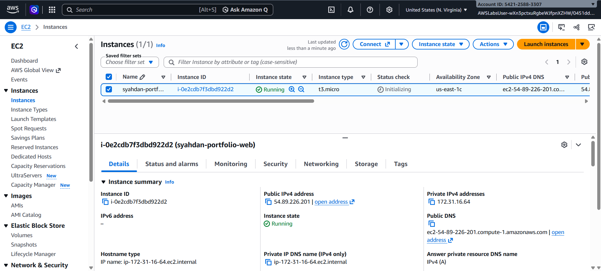
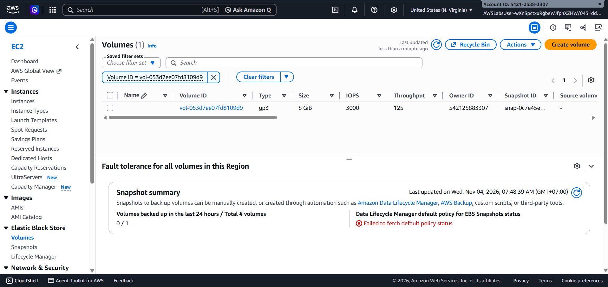
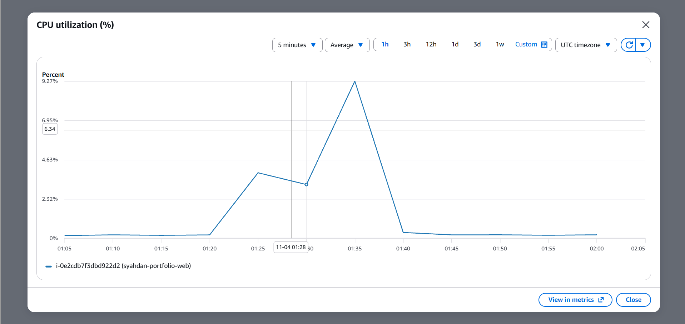
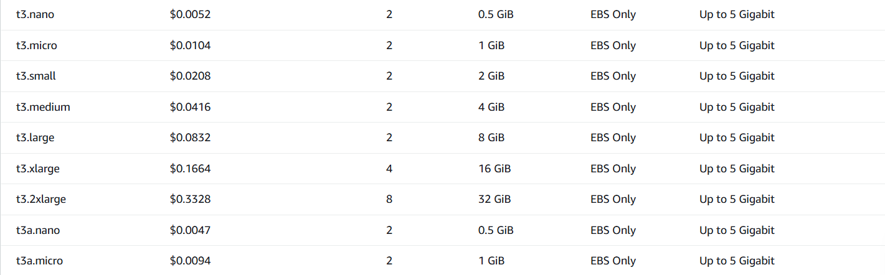
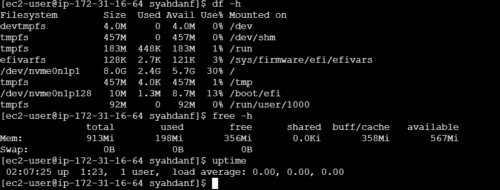

# 06 — AWS Cost Analysis & Optimization

## 1. Ringkasan

Analisis biaya dilakukan untuk memperkirakan biaya infrastruktur website portofolio React + Vite yang di-deploy pada Amazon EC2.

Proyek menggunakan AWS Academy / Skill Builder Lab, sehingga analisis ini menggunakan estimasi harga publik AWS, bukan tagihan aktual.

Tujuan analisis:
- Mengidentifikasi komponen biaya cloud.
- Mengestimasi biaya operasional bulanan.
- Membandingkan skenario penggunaan 24/7 dan lab.
- Mengevaluasi peluang optimasi berdasarkan utilisasi.
- Membedakan estimasi, rekomendasi, dan penghematan aktual.

## 2. Infrastruktur yang Dianalisis

| Komponen | Konfigurasi |
|---|---|
| Provider | AWS |
| Region | us-east-1 |
| Compute | EC2 t3.micro |
| vCPU | 2 |
| Memory | 1 GiB |
| Storage | EBS gp3 |
| Storage Capacity | 8 GiB |
| Public IPv4 | 1 alamat |
| Web Server | Nginx 1.30.6 |
| Application | React + Vite |
| Monitoring | CloudWatch |

## 3. Asumsi Perhitungan

Tanggal referensi harga: 4 November 2026.

| Parameter | Asumsi |
|---|---|
| Currency | USD |
| EC2 Purchase Option | Linux On-Demand |
| Jam operasional penuh | 730 jam/bulan |
| Jam operasional lab | 80 jam/bulan |
| EBS | Dialokasikan satu bulan |
| Public IPv4 | Mengikuti jam instance aktif |
| Data Transfer Out | Diasumsikan dalam kuota gratis |
| Pajak | Tidak termasuk |
| Snapshot | Tidak termasuk |
| CPU Credit Tambahan | Tidak termasuk |

Perhitungan menggunakan harga referensi dan dapat berbeda dari tagihan aktual.

## 4. Harga Resource

| Resource | Harga Referensi |
|---|---|
| EC2 t3.micro | $0.0104/jam |
| EBS gp3 | $0.08/GiB-bulan |
| Public IPv4 | $0.005/jam |
| Basic EC2 Monitoring | $0 tambahan |

Harga EC2 `t3.micro` $0.0104/jam terlihat pada [screenshot daftar harga AWS](../screenshots/comparison/01-aws-ec2-pricing.png). Tarif EBS gp3 ($0.08/GB-bulan, termasuk 3.000 IOPS dan 125 MB/s) dan public IPv4 ($0.005/jam) dicek pada halaman harga AWS pada 4 November 2026.

Sumber:
- https://aws.amazon.com/ec2/pricing/on-demand/
- https://aws.amazon.com/ebs/pricing/
- https://aws.amazon.com/vpc/pricing/
- https://aws.amazon.com/cloudwatch/pricing/

## 5. Skenario A — Operasional 24/7

Asumsi instance berjalan 730 jam per bulan.

### Compute

730 × $0.0104 = $7.592

### Storage

8 × $0.08 = $0.64

### Public IPv4

730 × $0.005 = $3.65

### Total

$7.592 + $0.64 + $3.65 = $11.882

**Estimasi total: $11.88/bulan**

## 6. Skenario B — Penggunaan Lab

Asumsi instance berjalan 80 jam per bulan.

### Compute

80 × $0.0104 = $0.832

### Storage

8 × $0.08 = $0.64

### Public IPv4

80 × $0.005 = $0.40

### Total

$0.832 + $0.64 + $0.40 = $1.872

**Estimasi total: $1.87/bulan**

Storage tetap dialokasikan selama satu bulan, sedangkan alamat IPv4 publik diasumsikan hanya digunakan selama 80 jam.

## 7. Perbandingan Biaya

| Komponen | 24/7 | Lab |
|---|---:|---:|
| EC2 | $7.59 | $0.83 |
| EBS | $0.64 | $0.64 |
| Public IPv4 | $3.65 | $0.40 |
| Total | $11.88 | $1.87 |

Selisih estimasi biaya:

$11.882 - $1.872 = $10.01/bulan

Persentase perbedaan:

($10.01 / $11.882) × 100% = 84.25%

Perbedaan tersebut berasal dari asumsi jam penggunaan, bukan hasil optimasi yang sudah diterapkan.

Skenario 80 jam tidak menyediakan availability 24/7 sehingga tidak dapat dianggap sebagai pengganti langsung untuk website production.

## 8. Analisis Berdasarkan Monitoring

Data monitoring awal:

| Metrik | Hasil |
|---|---|
| CPU Utilization | 0.27% |
| CPU Utilization (puncak, saat build) | 9.27% |
| Network In (puncak) | 27.18 MB |
| Network Out (puncak) | 668.4 kB |
| Disk Used | 2.4 GiB (`df -h`) |
| EBS Provisioned | 8 GiB |
| Disk Utilization | 30% |
| Memory Used | 198 MiB dari 913 MiB (±22%) |

Satuan jaringan adalah bytes. Rincian ada di [05 — Monitoring](05-monitoring-utilization.md).

### Analisis Compute

CPU sebesar 0.27% menunjukkan penggunaan komputasi sangat rendah pada pengamatan awal.

Hal ini mengindikasikan peluang evaluasi ukuran instance, tetapi belum cukup untuk membuktikan overprovisioning.

CPU puncak 9.27% terjadi saat build di server. Data tambahan yang masih diperlukan: CPU credits, memori puncak saat build, dan performa pada trafik lebih tinggi.

### Analisis Storage

Penggunaan disk 30% menunjukkan bahwa kapasitas storage masih mencukupi.

Belum ada kebutuhan untuk menambah volume EBS.

## 9. Rekomendasi Optimasi

| Rekomendasi | Dasar | Status |
|---|---|---|
| Evaluasi right-sizing | CPU 0.27% | Belum diterapkan |
| Pertahankan EBS 8 GiB | Disk usage 30% | Rekomendasi |
| Hentikan lab saat tidak digunakan | Mengurangi jam compute | Rekomendasi |
| Evaluasi static hosting | Website berupa static build | Belum diuji |
| Pantau CPU dan network lebih lama | Data masih terbatas | Rekomendasi |
| Hindari resource tambahan tanpa kebutuhan | Workload sederhana | Rekomendasi |

### 9.1 Right-Sizing

Instance t3.micro dapat dibandingkan dengan instance lebih kecil atau alternatif arsitektur. Pada daftar harga AWS, `t3.nano` (0.5 GiB) berharga $0.0052/jam atau sekitar $3.80 per 730 jam (compute saja).

Namun, build `npm` berjalan di server dan memori puncak saat build belum diukur, sehingga pindah ke `t3.nano` belum dapat direkomendasikan. Pemilihan instance harus mempertimbangkan memory, kompatibilitas aplikasi, dan kebutuhan performa.

### 9.2 Static Website Hosting

Karena React + Vite menghasilkan file statis, alternatif object storage dan CDN dapat dievaluasi.

Alternatif tersebut dapat mengurangi kebutuhan pengelolaan server, tetapi biaya dan kelayakannya harus dihitung terpisah.

### 9.3 Operational Scheduling

Untuk penggunaan lab atau demo, penghentian instance ketika tidak digunakan dapat mengurangi jam compute yang ditagihkan dalam simulasi akun berbayar.

Namun, resource storage dan beberapa komponen lain dapat tetap menimbulkan biaya.

## 10. Status Penghematan

| Kategori | Hasil |
|---|---|
| Estimasi biaya 24/7 | $11.88/bulan |
| Estimasi biaya lab | $1.87/bulan |
| Selisih skenario | $10.01/bulan |
| Rekomendasi optimasi | Sudah disusun |
| Right-sizing aktual | Belum dilakukan |
| Penghematan aktual | Belum terverifikasi |

Tidak ada klaim penghematan biaya aktual.

## 11. Keterbatasan

- Menggunakan AWS Academy / Skill Builder Lab.
- Tidak menggunakan data tagihan aktual.
- AWS Compute Optimizer tidak tersedia karena permission IAM.
- AWS Pricing Calculator belum digunakan.
- Harga dapat berubah.
- Pajak, snapshot, transfer berbayar, dan biaya tambahan tidak dihitung.
- Monitoring masih terbatas.
- Belum ada hasil pengujian right-sizing.

## 12. Evidence

### EC2 Instance

### EBS Volume

### CPU Monitoring

### Daftar Harga EC2 AWS

### Utilisasi Linux

## 13. Kontribusi Pribadi

Dalam analisis biaya ini, saya:

1. Mengidentifikasi resource cloud yang digunakan.
2. Menentukan asumsi biaya dan jam penggunaan.
3. Menghitung estimasi compute, storage, dan IPv4.
4. Membandingkan skenario 24/7 dan lab.
5. Menghubungkan temuan monitoring dengan peluang optimasi.
6. Menyusun rekomendasi right-sizing.
7. Mendokumentasikan batasan AWS Academy Lab.
8. Memisahkan estimasi biaya dari penghematan aktual.

## 14. Kesimpulan

Estimasi biaya infrastruktur website React + Vite menggunakan EC2 t3.micro, EBS gp3 8 GiB, dan public IPv4 adalah sekitar $11.88 per bulan untuk operasional 24/7.

Untuk skenario penggunaan lab selama 80 jam, estimasi biaya adalah sekitar $1.87 per bulan dengan asumsi storage tetap dialokasikan sepanjang bulan.

Monitoring awal menunjukkan utilisasi CPU rendah, memori terpakai ±22%, dan storage 30% dari kapasitas.

Terdapat peluang evaluasi optimasi compute dan alternatif hosting, tetapi belum dilakukan perubahan infrastruktur atau pembuktian penghematan aktual.

**Status: Cost Estimation Completed**

**Actual Savings: Not Verified**
