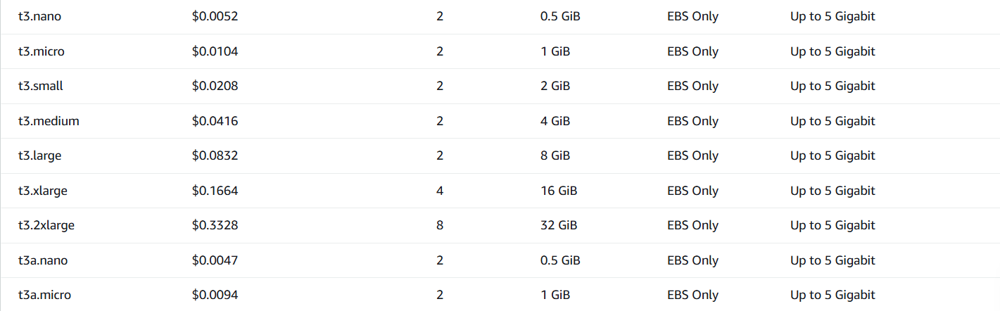
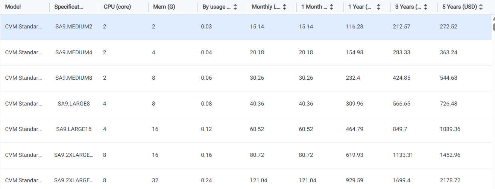
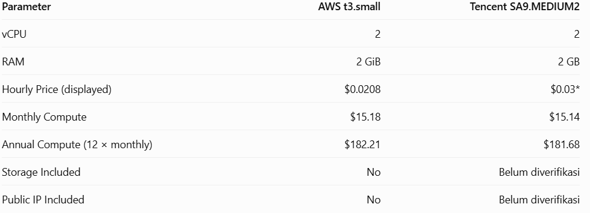

# 07 — AWS vs Tencent Cloud: Infrastructure & Cost Comparison

**Tanggal pemeriksaan sumber:** 4 November 2026  
**Proyek:** Deployment website portofolio React + Vite menggunakan Nginx  
**Jenis studi:** Perbandingan berbasis implementasi AWS dan harga publik Tencent Cloud; **bukan** hasil deployment Tencent Cloud.

## 1. Tujuan

Membandingkan kebutuhan infrastruktur, struktur biaya, operasional, dan kelayakan AWS EC2 dengan Tencent Cloud CVM untuk website React + Vite yang menghasilkan file statis.

## 2. Workload dan batas perbandingan

- Aplikasi: React + Vite, disajikan oleh Nginx.
- AWS aktual: EC2 `t3.micro`, 2 vCPU, 1 GiB RAM, EBS gp3 8 GiB, region `us-east-1`.
- Tencent Cloud kandidat: CVM `SA9.MEDIUM2`, 2 vCPU, **2 GB RAM**; tidak identik dengan AWS t3.micro.
- Simulasi operasional AWS: 730 jam per bulan.
- Harga dalam USD, sebelum pajak dan biaya tambahan.
- Belum ada instance Tencent Cloud yang dibuat atau diuji.
- Harga Tencent Cloud yang ditemukan belum dipastikan berlaku pada region yang sepadan dengan `us-east-1`; perbandingan geografis dan performa jaringan tidak dianggap setara.

## 3. Perbandingan teknis

| Parameter | AWS | Tencent Cloud |
|---|---|---|
| Compute | EC2 t3.micro | CVM SA9.MEDIUM2 (kandidat) |
| vCPU | 2 | 2 |
| RAM | 1 GiB | 2 GB |
| Sistem operasi | Linux | Linux (opsi tersedia) |
| Web server | Nginx (terimplementasi) | Nginx (rencana) |
| Storage | EBS gp3, 8 GiB | Cloud disk; tipe, kapasitas minimum dan harga belum diverifikasi |
| Network | VPC, Security Group, Internet Gateway | VPC, Security Group, akses internet sesuai konfigurasi CVM |
| Monitoring | Amazon CloudWatch (telah digunakan) | Cloud Monitor (belum diuji) |
| Status | Deployed, functional testing 8/8 PASS | Belum deployed |

## 4. Harga publik dan sumber

### AWS (us-east-1)

| Resource | Harga asumsi | Perhitungan 730 jam | Estimasi |
|---|---:|---|---:|
| EC2 t3.micro Linux On-Demand | $0.0104/jam | 730 × 0.0104 | $7.592 |
| EBS gp3 | $0.08/GiB-bulan | 8 × 0.08 | $0.640 |
| Public IPv4 | $0.005/jam | 730 × 0.005 | $3.650 |
| **Total** | | | **$11.882 ≈ $11.88/bulan** |

Tarif EBS dan IPv4 adalah asumsi referensi untuk `us-east-1` yang harus diperiksa ulang sebelum keputusan pembelian. Biaya data transfer berbayar, pajak, snapshot, log tambahan, dan surplus CPU credit tidak termasuk.

### Tencent Cloud (indikasi harga publik)

Halaman harga publik Tencent Cloud menampilkan model **SA9.MEDIUM2 (2 vCPU, 2 GB RAM)** dengan **Monthly List Price $15.14**. Halaman juga mencantumkan nilai pay-as-you-go yang dibulatkan ($0.03/jam); nilai itu **tidak boleh langsung dikalikan 730 jam dan dianggap setara dengan harga bulanan $15.14** karena jenis harga dan pembulatannya berbeda.

| Resource | Nilai yang dapat didokumentasikan | Status |
|---|---|---|
| CVM SA9.MEDIUM2 | $15.14/bulan (harga bulanan yang ditampilkan) | Referensi publik; region/opsi pembelian perlu dikonfirmasi |
| Cloud disk | Belum ada harga yang terverifikasi untuk konfigurasi kandidat | Belum dihitung |
| Public IP dan bandwidth | Halaman menunjukkan opsi IP publik dan biaya jaringan terpisah | Belum dihitung |
| Total infrastruktur | **Tidak tersedia** | Jangan diklaim sebagai $15.14 total |

Halaman Tencent Cloud juga menampilkan angka **$0.12/GB** untuk opsi trafik pada konfigurasi halaman yang terbaca, tetapi penerapannya untuk region dan pilihan instance yang dibandingkan belum diverifikasi; angka ini **tidak dimasukkan ke total**.

## 5. Perbandingan biaya: apa yang valid?

| Ukuran perbandingan | AWS | Tencent Cloud |
|---|---:|---:|
| Compute saja, acuan bulanan | $7.59 (730 jam On-Demand) | $15.14 (monthly list price yang ditampilkan) |
| Storage | $0.64 | Belum diketahui |
| IPv4 | $3.65 | Belum diketahui |
| **Total estimasi** | **$11.88** | **Belum dapat ditentukan** |

**Penting:** Harga compute di atas memakai model pembelian yang berbeda (AWS On-Demand vs Tencent monthly list price). Perbandingan ini hanya **indikatif**, bukan perbandingan *apples-to-apples* dan bukan dasar menghitung persentase penghematan lintas provider.

### Pembanding dengan RAM setara: AWS t3.small

Karena SA9.MEDIUM2 memiliki 2 GB RAM, pembanding AWS yang lebih setara spesifikasinya adalah `t3.small` (2 vCPU, 2 GiB). Perhitungan ini bersumber dari [daftar harga AWS](../screenshots/comparison/01-aws-ec2-pricing.png) dan [harga CVM Tencent](../screenshots/comparison/02-tencent-cvm-pricing.png).

| Parameter | AWS t3.small | Tencent SA9.MEDIUM2 |
|---|---:|---:|
| vCPU | 2 | 2 |
| RAM | 2 GiB | 2 GB |
| Harga per jam yang ditampilkan | $0.0208 | $0.03 (dibulatkan) |
| Compute bulanan | $15.18 (0.0208 × 730) | $15.14 (monthly list price) |
| Compute tahunan (12 × bulanan) | $182.21 | $181.68 |
| Storage termasuk | Tidak | Belum diverifikasi |
| Public IP termasuk | Tidak | Belum diverifikasi |

Pada spesifikasi compute yang setara, selisihnya sekitar $0.04 per bulan (kurang dari 0,3%), sehingga compute kedua provider praktis setara. Selisih ini **tidak** bermakna sebagai penghematan: model pembelian berbeda, dan storage serta IP publik belum dihitung untuk Tencent. Ini juga bukan konfigurasi yang dideploy; yang berjalan adalah `t3.micro` (1 GiB). Tabel perhitungan ada di bagian Evidence.

## 6. Evaluasi operasional

**AWS:** Proyek sudah berhasil di-deploy, diakses melalui HTTP, dan lulus 8 dari 8 pengujian fungsional. CloudWatch menunjukkan CPU sekitar 0,3% pada kondisi normal (puncak 9,27% saat build), memori terpakai ±22%, dan disk 30% dari 8 GiB ([05 — Monitoring](05-monitoring-utilization.md)). Data ini tidak membuktikan performa Tencent Cloud.

**Tencent Cloud:** Secara konseptual dapat menjalankan file statis React + Vite dengan Linux dan Nginx, tetapi deployment, performa, keamanan, dan kemudahan operasi belum diuji pada proyek ini.

## 7. Rekomendasi

1. **Untuk portofolio saat ini:** pertahankan AWS sebagai platform yang telah terbukti berjalan dan memiliki bukti pengujian serta monitoring.
2. **Untuk evaluasi biaya lintas provider:** tetapkan region Tencent Cloud, tipe CVM, harga pembelian On-Demand, kapasitas disk minimum, public IP, bandwidth, dan trafik bulanan sebelum membandingkan total.
3. **Untuk static website:** pertimbangkan opsi object storage + CDN pada kedua provider sebagai studi alternatif terpisah; jangan mengasumsikan biayanya tanpa konfigurasi dan estimasi trafik.
4. **Untuk right-sizing:** lanjutkan pengamatan CPU, memori, dan network sebelum mengganti ukuran instance.

**Tidak ada migrasi, right-sizing, atau penghematan aktual yang diklaim.**

## 8. Evidence / Screenshot

### Harga EC2 AWS (t3.nano, t3.micro, t3.small, dan lainnya)

### Harga CVM Tencent Cloud (SA9.MEDIUM2 disorot)

Kolom pada screenshot Tencent terpotong, sehingga region dan opsi pembelian yang dipilih tidak terlihat. Karena itu keduanya tetap dicatat sebagai belum terverifikasi.

### Tabel perhitungan sendiri (indicative comparison)

## 9. Keterbatasan

- Tidak ada deployment atau benchmark Tencent Cloud.
- Konfigurasi memori tidak identik (AWS 1 GiB vs Tencent 2 GB).
- Harga compute yang dibandingkan memakai opsi pembelian berbeda.
- Region dan ketersediaan tipe CVM Tencent belum dipastikan.
- Harga cloud disk dan network Tencent belum lengkap.
- Biaya aktual AWS Academy / Skill Builder Lab bukan tagihan akun komersial.
- Angka dapat berubah menurut tanggal, region, diskon, dan pajak.

## 10. Kesimpulan

AWS EC2 merupakan pilihan yang **telah terimplementasi dan tervalidasi** untuk website portofolio ini. Estimasi biaya infrastruktur AWS dengan asumsi 730 jam per bulan adalah **$11.88/bulan**. Tencent Cloud CVM adalah alternatif yang layak diteliti, tetapi total biaya belum dapat dibandingkan secara adil tanpa harga disk, jaringan, region, dan model pembelian yang konsisten.

**Status:** Preliminary Cross-Cloud Comparison Completed; Tencent Total Cost Pending Verification.

## 11. Sumber

Diakses/diperiksa pada **4 November 2026**:

1. AWS EC2 On-Demand: https://aws.amazon.com/ec2/pricing/on-demand/
2. AWS instance sizing/pricing reference: https://docs.aws.amazon.com/prescriptive-guidance/latest/optimize-costs-microsoft-workloads/right-size-selection.html
3. AWS EBS Pricing: https://aws.amazon.com/ebs/pricing/
4. AWS VPC / Public IPv4 Pricing: https://aws.amazon.com/vpc/pricing/
5. Tencent Cloud CVM Pricing: https://indonesia.tencentcloud.com/pricing/cvm/overview

Harga merupakan cuplikan referensi publik pada tanggal pemeriksaan, bukan jaminan harga saat pembelian.
